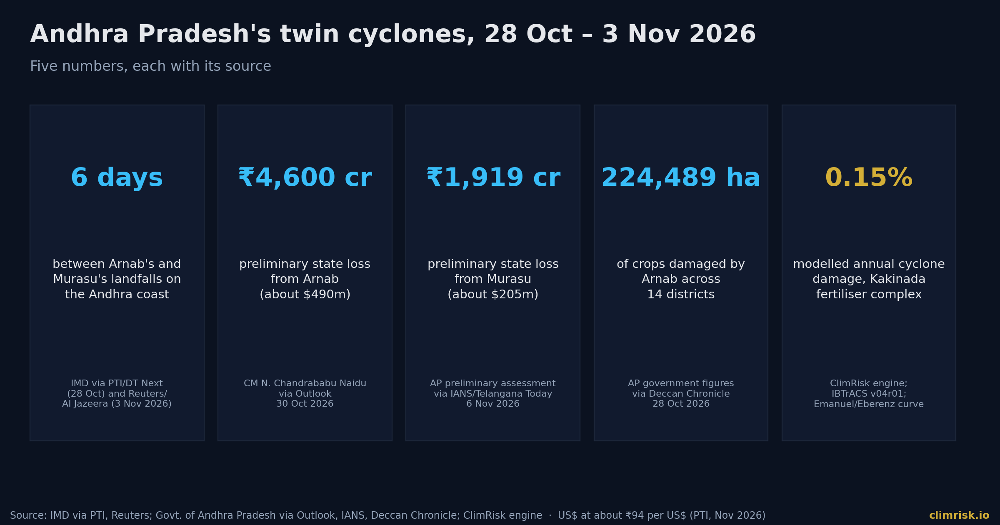
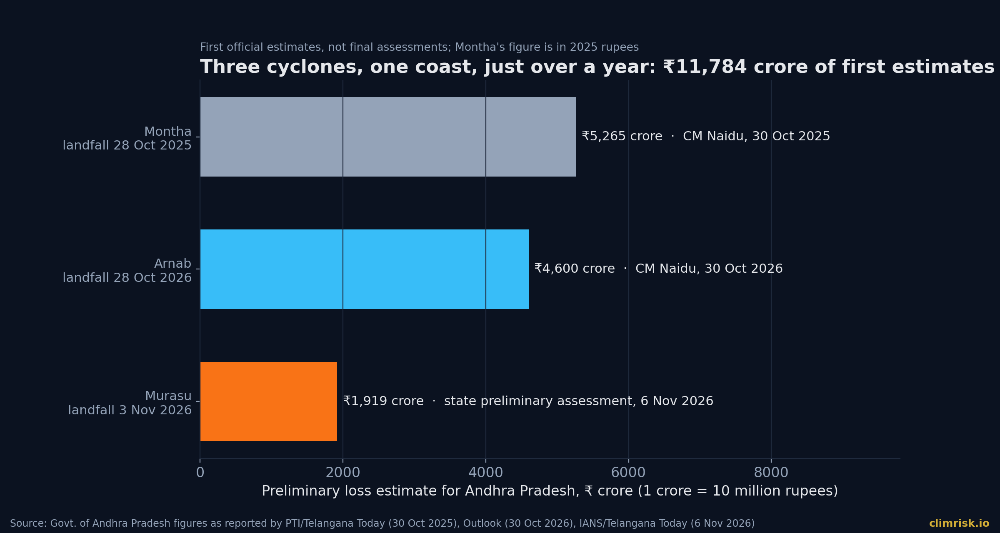
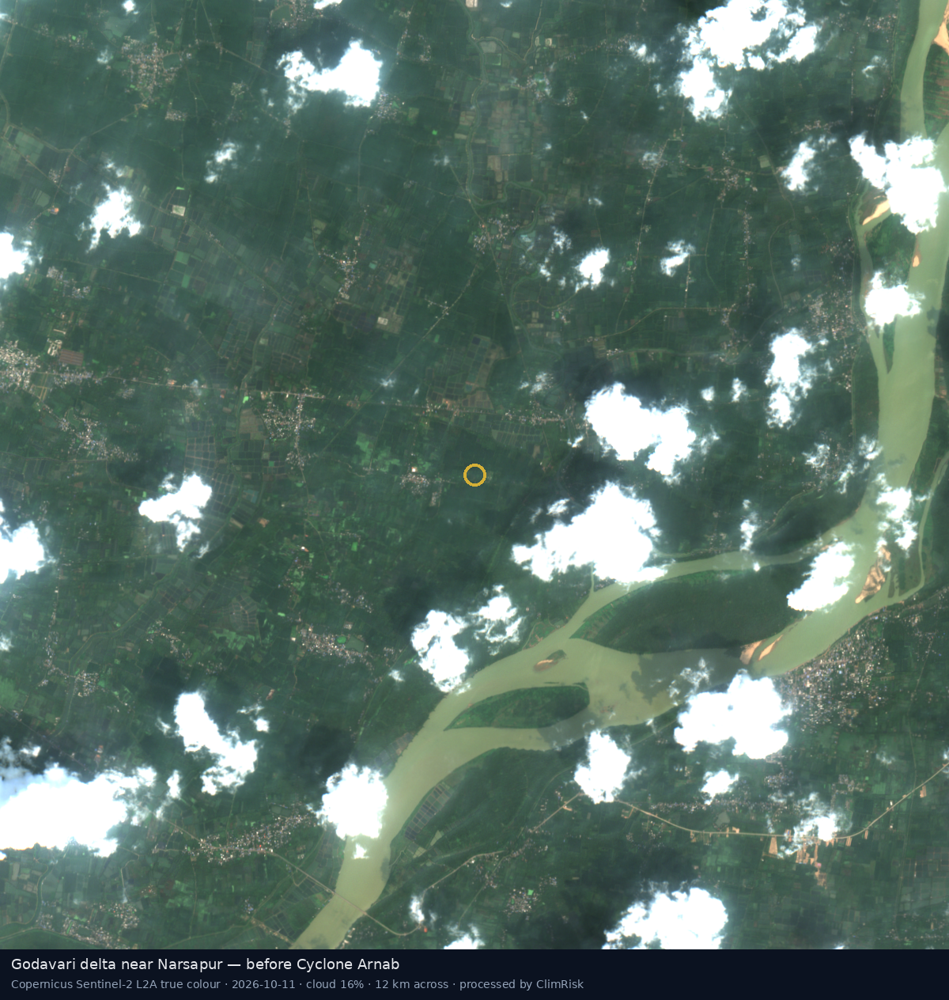
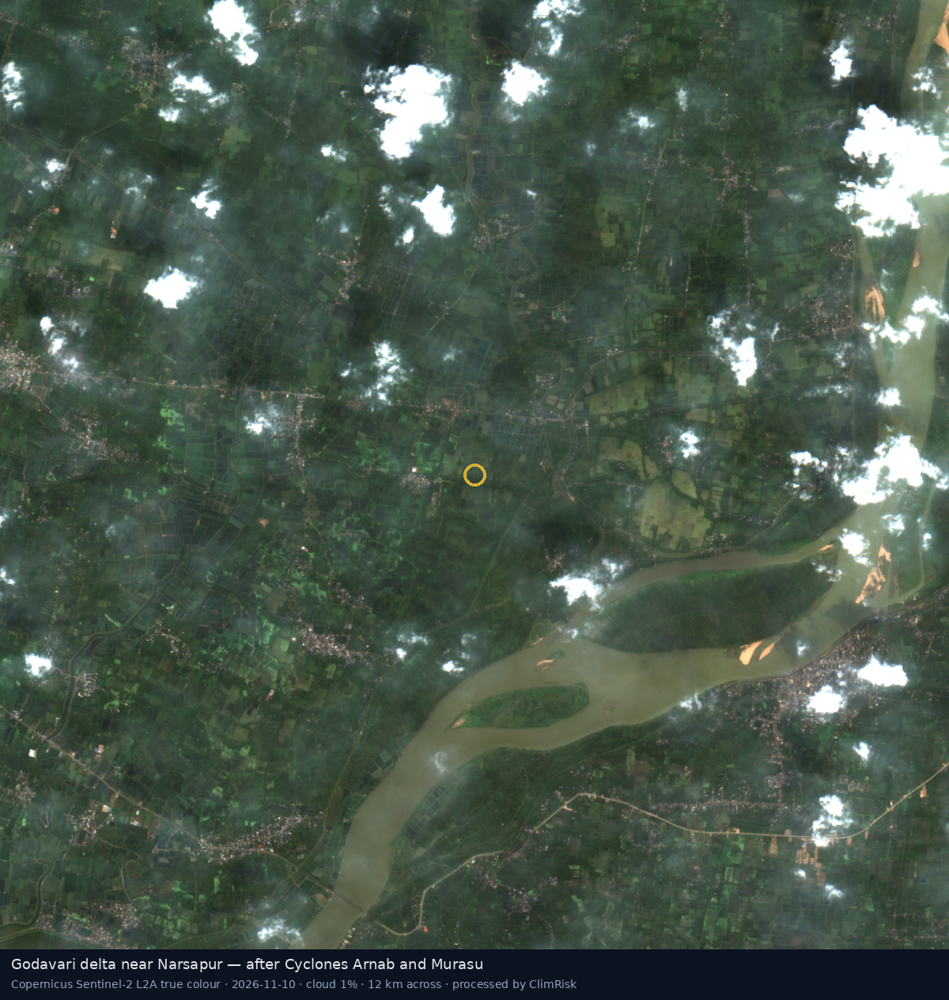
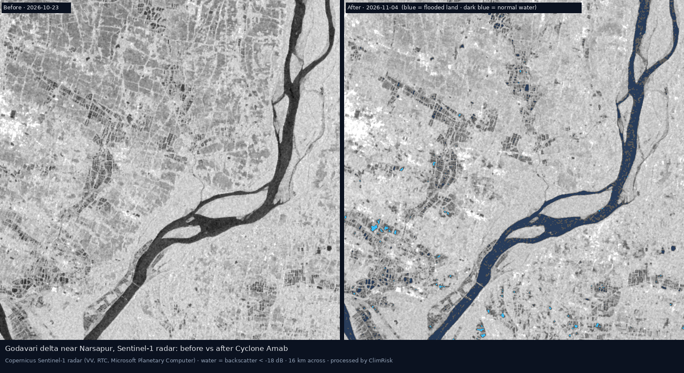
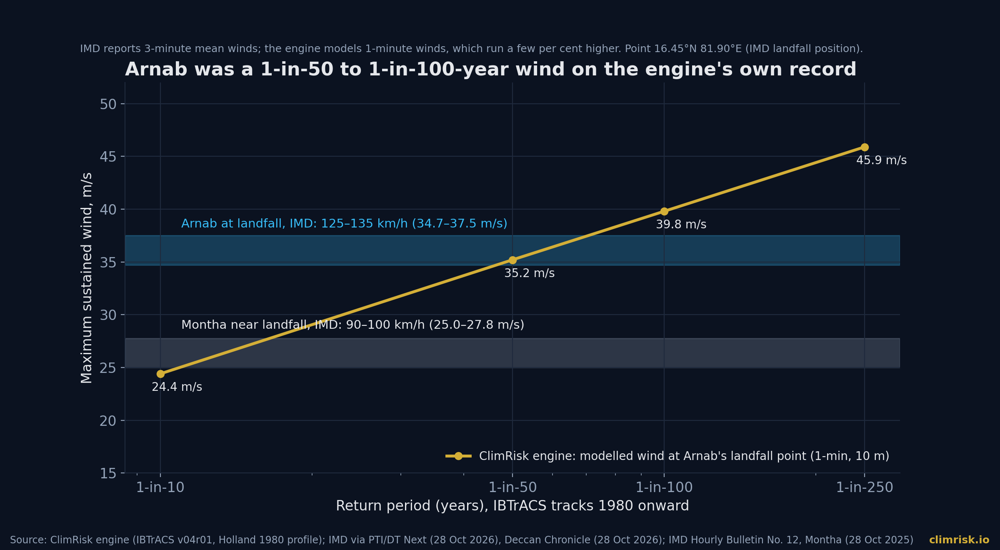
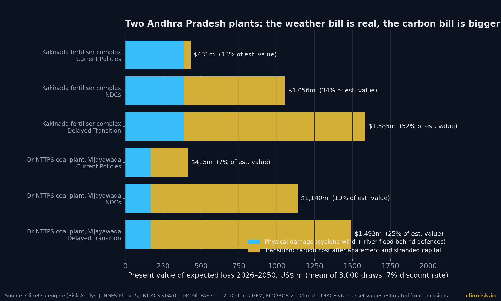

Between 2 a.m. and 8 a.m. on Wednesday 28 October 2026, Cyclone Arnab crossed the Andhra Pradesh and Yanam coast near 16.45°N, 81.90°E, about 20 km east-north-east of Narsapur. The India Meteorological Department classed it a very severe cyclonic storm at landfall. **[IMD via PTI 2026]** Winds ran at 125–135 km/h, gusting to 150 km/h. **[Deccan Chronicle 2026]**

Six days later, at about 1 a.m. on Tuesday 3 November, Cyclone Murasu came ashore near Ongole, some 200 km down the same coast, as a severe cyclonic storm. **[Reuters/Al Jazeera 2026]**

One more date makes the pattern hard to ignore. On the evening of 28 October 2025, exactly a year before Arnab, Severe Cyclonic Storm Montha was crossing the coast near Kakinada, its centre at 16.25°N, 81.7°E. **[IMD Bulletin 2025]** That is roughly 30 km from where Arnab made landfall.

Andhra Pradesh's own first estimates put the three storms at ₹5,265 crore (Montha), ₹4,600 crore (Arnab) and ₹1,918.55 crore (Murasu). **[PTI 2025; Outlook 2026; IANS 2026]** That is ₹11,784 crore of preliminary losses on one coast in just over a year. At about ₹94 to the dollar, the two 2026 storms alone come to roughly $690 million. **[PTI 2026]**

This piece is about what that clustering does to a climate-risk number. Our engine, like most physical-risk screens, treats each year's storms as an independent draw from a historical record. The Andhra coast has just drawn twice in a week, a year after the last draw.

## The Storms: Two Hits, One Week

Arnab was the stronger storm. Rain over the 20 hours to landfall topped 200 mm at several stations, including 261.5 mm at Kannuripalem in Anakapalli district. **[IMD via PTI 2026]** By that evening Gopalapatnam had logged 323.2 mm. **[Deccan Chronicle 2026]** IMD had forecast a storm surge of up to 1.5 m above the tide. **[Reuters/Al Jazeera 2026]** The Uppada coastal road near Kakinada was "completely washed away". **[PTI 2026]**

Murasu was weaker but landed on ground that had not dried out. IMD said it would weaken to a cyclonic storm with 80–90 km/h winds by noon on 3 November. **[Down To Earth 2026]** Storm surges were reported in Bapatla, Prakasam and Krishna districts. **[Down To Earth 2026]** A fisherman from Kothapatnam told Reuters it was "the most dangerous cyclone we have witnessed in the last 14 years." **[Reuters/Al Jazeera 2026]**

Deaths stayed in single figures for each storm, nine for Arnab and eight for Murasu, helped by evacuations of at least 180,000 people before Arnab. **[Deccan Chronicle 2026; IANS 2026; Reuters/Al Jazeera 2026]**

> **SOURCE — IPCC AR6 WGI, Summary for Policymakers (2021), A.3.4:** "It is likely that the global proportion of major (Category 3–5) tropical cyclone occurrence has increased over the last four decades."

We make no attribution claim for these storms. The point for investors is narrower: the historical record a model is calibrated on is not a fixed target.

## What the Wind and Water Did

The losses fell on the things a coastal economy runs on: crops, roads, power lines and boats.

Arnab damaged 224,489 hectares of crops across 14 districts, almost all of it paddy, affecting about 345,000 farmers. West Godavari alone lost 76,176 hectares. **[Deccan Chronicle 2026]** Murasu added about 143,000 hectares of farmland and 6,749 hectares of horticulture. **[IANS 2026]**

The grid took repeated hits. After Arnab, the central distribution company reported damage at 156 substations and in 857 villages. **[Deccan Chronicle 2026]** The state's energy minister put preliminary damage to electricity infrastructure at about ₹500 crore, with 3,700 poles down in West Godavari alone. **[Outlook 2026]** A week later Murasu put 1,103 11-kV feeders and 3,946 poles out of service. **[IANS 2026]**

Murasu also damaged 760 km of major roads and 346 fishing boats. **[IANS 2026]** During Arnab, 36 trains were cancelled on the Howrah–Chennai line. **[Outlook 2026]**

The breakdown of Montha's estimate a year earlier shows where coastal storm money goes. Of ₹5,265 crore, ₹2,079 crore was roads and buildings, ₹1,270 crore fisheries and ₹829 crore agriculture. **[PTI 2025]**

We looked from space at the Godavari delta near Narsapur, close to Arnab's landfall. Sentinel-2's optical camera had a clear view on 11 October and again on 10 November. A fortnight after landfall, the paddy grid looks much as it did before.

Radar sees through cloud, but the first Sentinel-1 pass after Arnab came on 4 November, seven days late. Comparing it with a 23 October pass over a 16 km frame, ClimRisk's water mask found about 0.38 km² of new open water.

As in our Florida piece, the small number is the lesson: wind damage to poles and standing crops leaves little trace from orbit, and floodwater in a drained delta recedes within days.

## Who and What Is Exposed

The Andhra coast is not just paddy and fishing villages. The ClimRisk asset register, built from Climate TRACE, holds 81 facility records across coastal Andhra Pradesh from Nellore district to Kakinada and inland to the Telangana coal belt: cement kilns, coal mines, coal and gas power plants, a fertiliser complex and edible-oil refineries. We picked two large emitters near the storm tracks:

- **Kakinada fertiliser complex**, an ammonia site on the port coast that our register attributes to Coromandel International, about 70 km north-east of Arnab's landfall. Register emissions: 4.97 Mt CO₂e a year.
- **Dr Narla Tata Rao Thermal Power Station**, a 2,560 MW state-owned coal plant on the Krishna river near Vijayawada, about 130 km from Murasu's landfall. Register emissions: 13.2 Mt CO₂e a year.

We have no report of damage at either site, and we do not suggest there was any. After Murasu, the Krishna was carrying 43,500 cusecs through the Prakasam Barrage downstream of the plant, with 60 of its 70 gates open. **[IANS 2026]** We use the two plants to ask a narrower question: what does a standard climate-risk screen tell a lender about them?

## What the ClimRisk Engine Says

Start with the hazard at Arnab's landfall point. The engine's track record holds 40 storms within 200 km since 1980, and tropical-storm-force winds about 0.28 times a year. Only one storm in 46 years, an unnamed 1996 cyclone, reached Category 1 or above at the point. The modelled 1-in-50-year wind is 35.2 m/s and the 1-in-100-year wind 39.8 m/s. **[ClimRisk engine 2026]**

Arnab's reported 125–135 km/h is 34.7–37.5 m/s. IMD reports 3-minute winds, which run a little below the 1-minute winds the engine models. On the engine's own record, Arnab was a 1-in-50 to 1-in-100-year wind at landfall.

Two things follow. First, the engine's copy of the IBTrACS record does not yet contain Montha, Arnab or Murasu. None of the three storms that cost the state ₹11,784 crore is in its history. Adding them will raise the modelled frequency on this coast.

Second, the engine treats storm arrivals as independent from year to year. At a rate of 0.28 tropical-storm-force events a year, the chance of two such events at one point within a single year is about 3%, or roughly 1-in-30. Montha's centre passed about 30 km from Arnab's landfall point, a year earlier to the day. One unlucky year does not prove the model wrong. It does show why a single expected-loss figure hides the risk that matters to a cash-flow model: a second hit before repairs are finished.

Now the two plants. For the **Kakinada fertiliser complex**, the engine puts cyclone damage at 0.15% of asset value a year, with a 1-in-100-year wind of 38.2 m/s (Category 1). River flood is larger: the JRC maps put an undefended 1-in-100-year depth of 7.0 m at the register coordinate, behind defences that FLOPROS lists at a 1-in-100 standard. Coastal flood is zero. Total modelled annual damage is 1.01% of value. **[ClimRisk engine 2026]**

That flood depth needs a site survey before anyone relies on it. The register point may fall on a creek cell rather than the plant platform. We report it because it drives the spread. The present value of physical loss from 2026 to 2050 has a mean of $387m but a median of only $16m, and a 95th percentile of $2.07bn. That is the shape of a defended site: most years nothing, occasionally a great deal. **[ClimRisk engine 2026]**

For **Dr NTTPS**, the weather bill is smaller. Modelled annual damage is 0.23% of value, split between cyclone wind (0.14%) and river flood (0.09%). The physical present value has a mean of $168m, a median of $26m and a 95th percentile of $761m. **[ClimRisk engine 2026]**

The carbon side is larger for both. No carbon price applies to either plant today. India's Carbon Credit Trading Scheme has no price yet, and its first intensity targets do not name fertilisers or coal power. **[World Bank Carbon Pricing Dashboard 2026]** Under NGFS Phase 5 Delayed Transition, a price of about $18 a tonne arrives in India in 2031 and climbs from there.

On that path, the fertiliser complex's mean loss to 2050 is $1.59bn, or 52% of an estimated $2.66bn value, with a 95th percentile of $3.17bn. Its carbon bill alone is $1.74bn if nothing is done, or $1.26bn with the sector's abatement levers. Under Current Policies, the mean falls to $431m (13%), most of it physical. **[ClimRisk engine 2026]**

For Dr NTTPS under Delayed Transition, the mean is $1.49bn, or 25% of an estimated $4.75bn value, with a 95th percentile of $2.67bn. Stranded capital is $702m of that. Under Current Policies, the mean is $415m (7%). **[ClimRisk engine 2026]**

Both values are estimated from emissions, so the percentages are indicative. The direction is not. In every transition scenario we ran, carbon outweighs weather for these two plants, even in a fortnight when the weather made the news.

## How the Loss Reaches Balance Sheets

For this coast, the first-round cost lands on public balance sheets. Roads, power distribution, irrigation and fisheries are mostly state-owned or state-supported. The state sought central help after Montha and Arnab, and the Union Home Minister promised assistance after Murasu. **[PTI 2025; Reuters/Al Jazeera 2026]** None of the official statements we read put a figure on insured loss.

For investors and lenders, four pathways matter.

1. **State and utility credit.** Three storms' worth of road and grid repairs in just over a year is a fiscal cost for the state and its distribution companies, and rebuilding poles and feeders earns no new return.
2. **Agricultural credit.** Paddy losses across hundreds of thousands of hectares, twice in one season, become stressed crop loans in rural banks and microfinance books.
3. **Business interruption.** Power cuts, closed roads and cancelled trains stop work at sites that are themselves undamaged. Our engine prices direct damage only.
4. **Model risk.** A physical-risk score calibrated to a record that ends before the latest three storms is, on this coast, a score of the past.

## What Investors, Lenders and Operators Should Do

First, ask how a model's storm record is dated. If the last three damaging cyclones are not in it, ask for a rerun when they are.

Second, look past the annual average. For a coastal asset, ask for the probability of two damaging events in one year and for the 95th-percentile loss, not just the mean. On this coast, back-to-back hits are a documented outcome, not a tail curiosity.

Third, for operators, plan for recovery time, not just peak wind. A site still waiting on grid repairs is exposed to the next storm.

Fourth, keep the carbon question in view. For both plants we ran, the transition bill is the larger number in every scenario that assumes policy tightens.

## Method and Limitations

The cyclone model uses NOAA IBTrACS v04r01 tracks since 1980 with a Holland (1980) wind profile; frequencies are historical, with no climate-change uplift, and the engine's copy of the record does not yet include the 2025–26 North Indian Ocean storms. River flood depths are from the JRC CEMS-GloFAS global maps v2.1.2 (undefended), coastal depths from Deltares Global Flood Maps v2021.06. FLOPROS assigns Andhra Pradesh a 1-in-100 design standard for river and coastal defences, a policy-layer value we have not verified. Neither flood layer models surface-water flooding from cyclone rain. Asset values are estimated from emissions. Direct physical damage only. Loss figures are first official estimates and will be revised. Rupee figures are converted at about ₹94 per US dollar. The two-events-a-year probability assumes independent (Poisson) arrivals at the engine's historical rate.

## How ClimRisk Measured This

We ran the ClimRisk engine's hazard screen at the IMD landfall positions of Arnab and Murasu, and its full four-stage Risk Analyst on two sites from our asset register: physical hazards with flood defences, carbon-pricing instruments in force (World Bank dashboard), NGFS Phase 5 transition scenarios, and a Monte Carlo loss distribution with 3,000 draws, a 7% discount rate and emissions unabated unless stated. Values are present values for 2026–2050 in US dollars; we report means, medians and 95th percentiles. Satellite scenes are real Copernicus data processed by ClimRisk. The finding we most want readers to take away is about time, not wind: a model's storm record can be a year or more behind the coast it describes.
