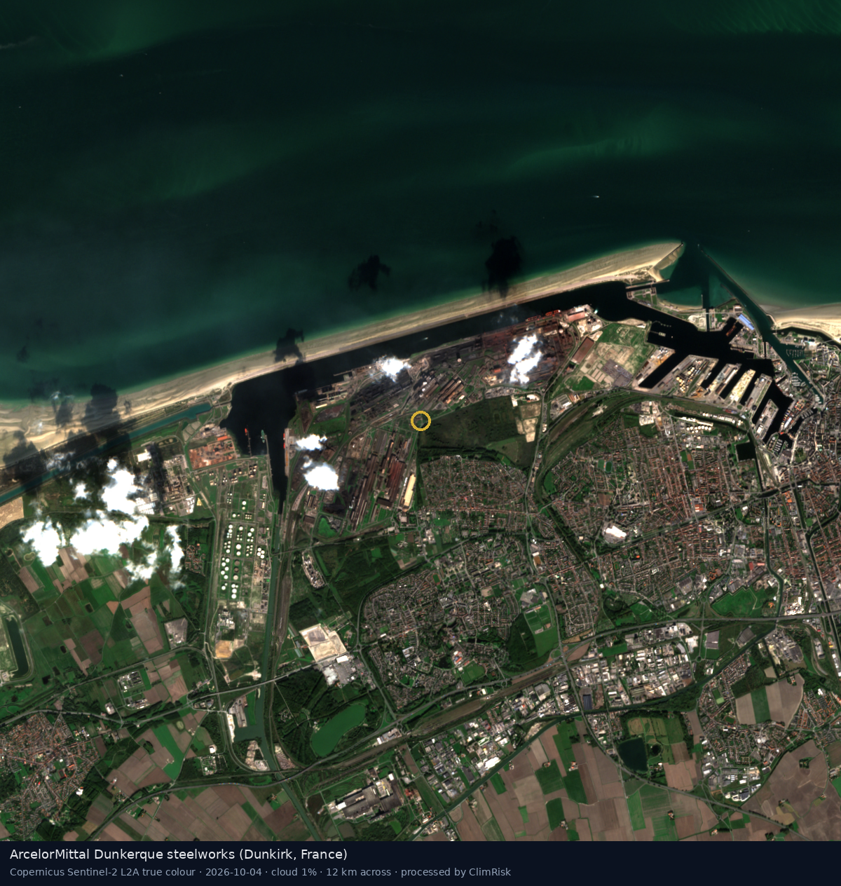
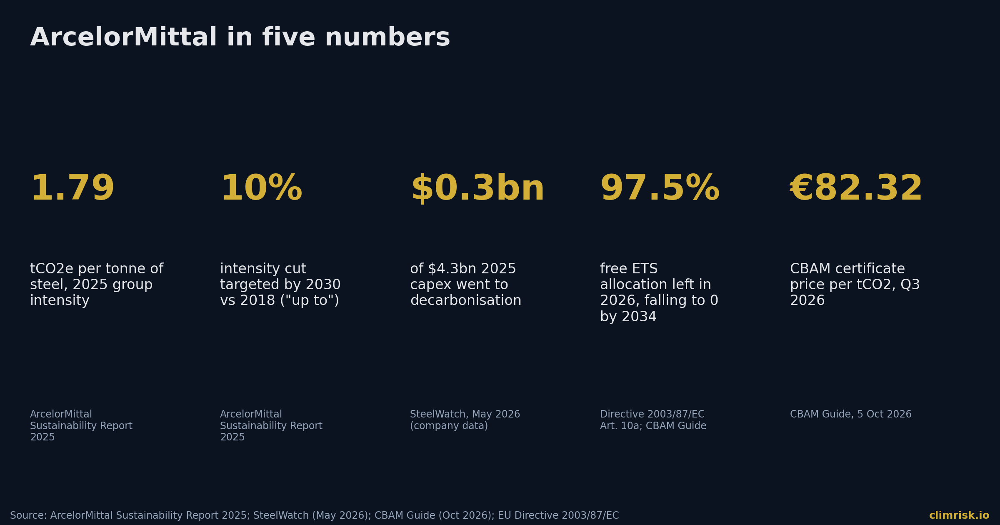
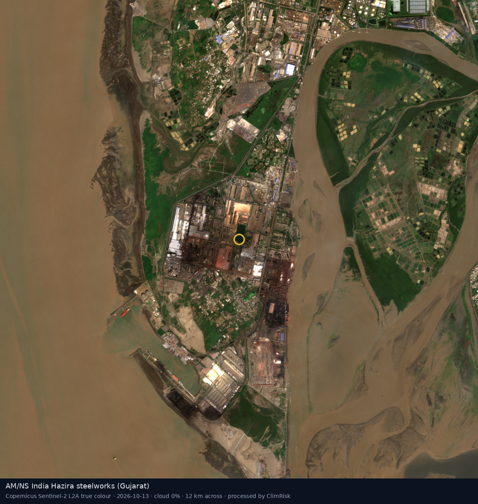
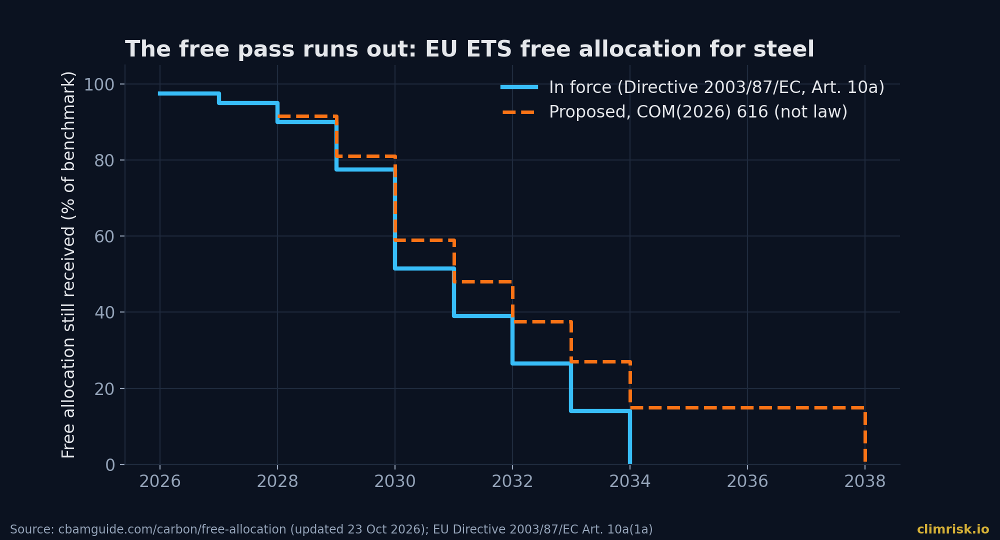
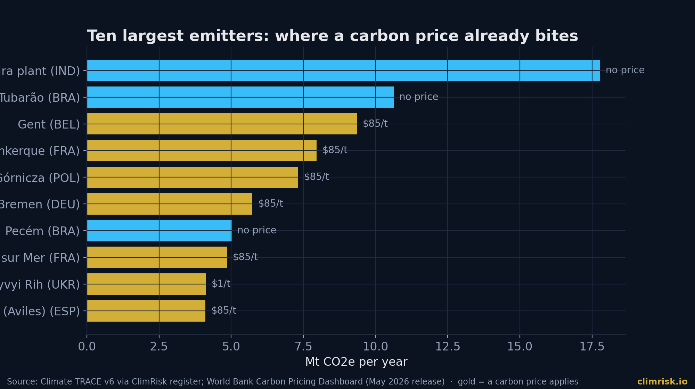
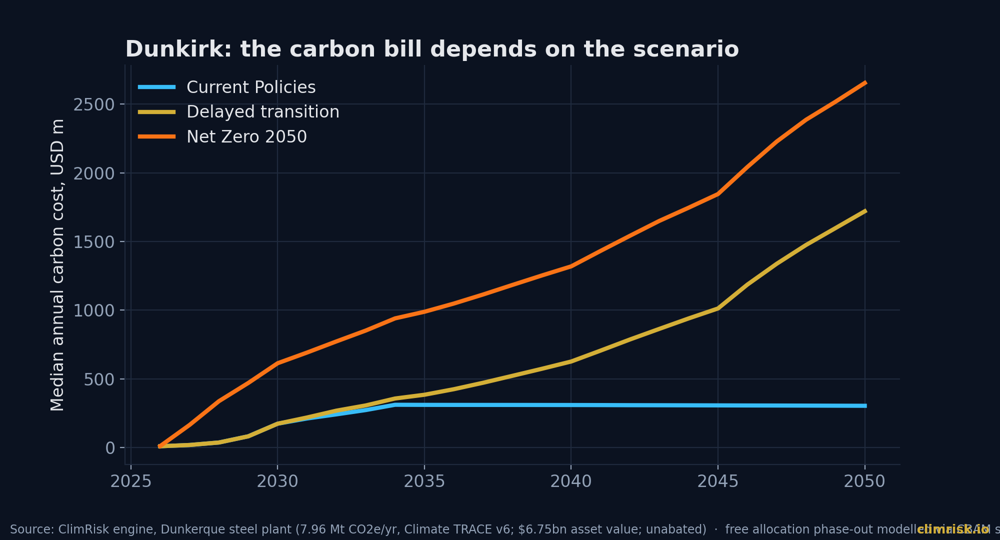
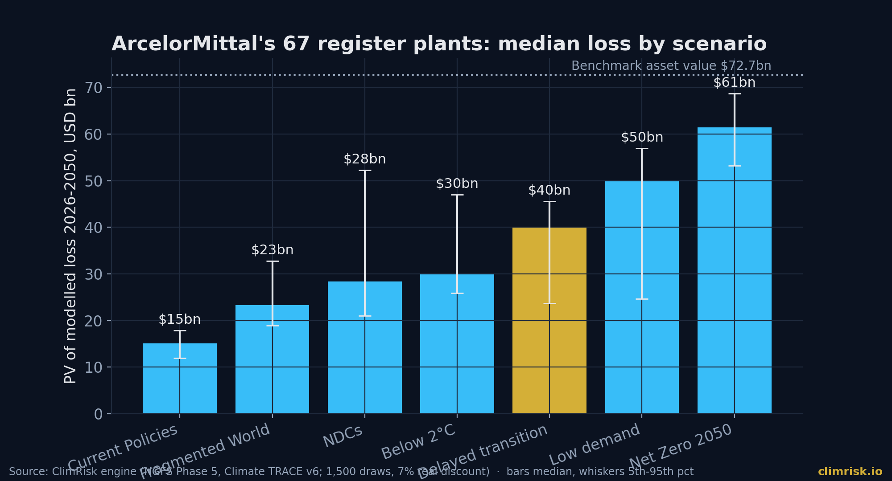
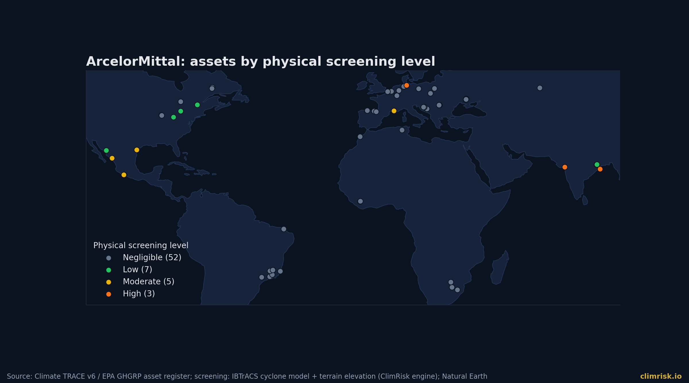

On 2 November 2026, ArcelorMittal published what analysts expect from its third quarter: EBITDA of $1,972 million and adjusted earnings of $0.84 a share, before non-cash charges for idling its Kryvyi Rih plant in Ukraine, which it announced on 25 September. **[ArcelorMittal 2026]** These are consensus numbers, not results. The real ones follow. But the shape of the quarter is already clear: a steelmaker still earning billions while the ground under its European plants is changing.

The ground is a carbon price. Not the one steelmakers pay today, but the one they will pay as free allowances run out. We ran ArcelorMittal's 67 register plants through the ClimRisk engine. The weather barely matters. The calendar does.

## A big emitter, with a modest plan

In 2025 ArcelorMittal made 55.6 million tonnes of crude steel on $61.4 billion of revenue. **[ArcelorMittal 2026]** Its own sustainability report puts group carbon intensity at 1.79 tonnes of CO2e per tonne of steel, and absolute emissions 47.7% lower than in 2018 once divestments are included. **[ArcelorMittal SR 2025]** Electric arc furnaces now make around 26% of its steel, up from 19% in 2018.

The 2030 ambition is smaller than it used to be. The report targets a cut in carbon intensity of "up to 10%" by 2030 against 2018, for Scopes 1 and 2. **[ArcelorMittal SR 2025]** The campaign group SteelWatch says the earlier group target was 25% and that a separate 35% target for Europe has disappeared. **[SteelWatch 2026]** That comparison comes from SteelWatch, not from the company's report as we read it.

The capital behind the plan is thin. Total 2025 capex was $4.3 billion, of which only $0.3 billion went to decarbonisation, according to SteelWatch's reading of company data. **[SteelWatch 2026]** The company says it is staying "within the group's existing" $4.5 to $5 billion annual envelope and sequencing projects for financial discipline. **[ArcelorMittal SR 2025]**

> **SOURCE — ArcelorMittal Sustainability Report 2025:** "our ambition to achieving net zero by 2050 remains in place"

The projects tell the story. SteelWatch reports that in June 2025 ArcelorMittal told the German government it could not proceed with hydrogen-based direct reduced iron at Bremen and Eisenhüttenstadt, giving up €1.3 billion of state aid, and that similar projects in France, Belgium, Spain and Canada were suspended, scaled back or delayed. **[SteelWatch 2026]** What survives in Europe is Dunkirk: a 2 million tonne electric arc furnace costing about €1.3 billion, which turns two blast furnaces into one blast furnace plus one electric arc furnace. **[ArcelorMittal SR 2025]**

## The physical picture: quiet

We screened all 67 plants. Flood depths were pulled live for the 20 largest emitters; the rest got a cyclone check only. Where flood maps were read, coastal flood screens negligible, including at Dunkirk, Ghent and Hazira, and cyclone risk is negligible at the largest sites. The highest modelled average annual damage in the register is 0.009% of asset value, at Hazira in Gujarat. River flood could not be read for any plant, so this is a lower bound. Direct damage only; business interruption is not modelled.

Water is the quieter warning. At Hazira, WRI Aqueduct 4.0 rates baseline water stress "Extremely High" and drought risk 0.8 to 1.0 on its index. **[WRI Aqueduct 2023]** At Dunkirk, drought risk is "Medium - High". These are flags for operations, not loss figures; the engine does not price them.

## The policy picture: the free pass runs out

Six of the ten largest emitters in the register sit under the EU ETS, which the engine prices at $84.9 per tonne in 2026 (World Bank Carbon Pricing Dashboard). **[World Bank 2026]** Together those six emit about 39 million tonnes a year. Until now, much of that has been covered by free allowances handed to industry.

That is ending. Under the law in force, free allocation for steel is multiplied by a factor that falls from 97.5% in 2026 to 95% in 2027, 90% in 2028, 77.5% in 2029, 51.5% in 2030, and on to zero in 2034. **[CBAM Guide 2026]** The biggest single step is 2029 to 2030. A Commission proposal published on 17 July 2026 would stretch the schedule, with 15% still allocated from 2034 to 2037 and zero only from 2038. **[CBAM Guide 2026]** It is a proposal. The Environment Council held a debate on 12 October and decided nothing.

The border price is moving too. The CBAM certificate price for Q3 2026 was €82.32 per tonne of CO2. **[CBAM Guide 2026]** Trade press reports that ArcelorMittal has urged the EU to extend CBAM and import quotas to downstream steel products. **[SteelOrbis 2026]** A producer asking for more protection is one that expects the carbon price to bite.

In India, Hazira faces no carbon price today. The engine reads $0 per tonne there, and the country's trading scheme is intensity-based.

## One plant, one bill: Dunkirk

Dunkerque in northern France emits about 8.0 million tonnes of CO2e a year (Climate TRACE) and is valued by the engine at $6.75 billion on a benchmark basis. We ran it as a standalone plant with emissions unabated and the schedule above. Median annual carbon cost:

- **Current Policies:** about $173 million in 2030, $310 million in 2035, then flat near $305 million to 2050.
- **Delayed transition:** $173 million in 2030, $384 million in 2035, $626 million in 2040, $1.72 billion in 2050.
- **Net Zero 2050:** $614 million in 2030, $988 million in 2035, $1.32 billion in 2040, $2.66 billion in 2050.

Present value of that carbon cost, 2026 to 2050 at 7% real, unabated: $2.8 billion under Current Policies (about 41% of the plant's value), $6.1 billion under Delayed transition (5th to 95th percentile $2.4 to $12.9 billion), and $13.4 billion under Net Zero 2050.

The first scenario matters most for lenders. Even with no new policy at all, the phase-out alone makes the cost about $310 million a year by 2035, nearly double 2030. The price stays at $85. The free allocation is what disappears.

Ghent behaves the same way: about 9.4 million tonnes, $5.2 billion of value, and $3.3 billion of unabated carbon cost in Current Policies against $7.1 billion in Delayed. Hazira is the opposite shape. It emits 17.8 million tonnes with no price today, so Current Policies costs only $0.2 billion, yet Delayed costs $5.6 billion and Net Zero $22.0 billion. Its exposure is a date, not a number.

## The portfolio view

The register values ArcelorMittal's 67 plants at about $72.7 billion on a benchmark basis, not book value. Present value of modelled climate loss, 2026 to 2050, median with 5th to 95th percentile range:

- **Current Policies:** $15.1 billion (19% of value); range $12.0 to 17.9 billion.
- **Delayed transition:** $40.1 billion (51%); range $23.7 to 45.5 billion.
- **Below 2°C:** $30.0 billion (38%); range $25.8 to 47.0 billion.
- **Net Zero 2050:** $61.4 billion (78%); range $53.2 to 68.7 billion.

The loss is capped at asset value in each draw, so the top of the range reflects plants priced out entirely, not a precise forecast. The spread between Current Policies and Delayed is the point. Same plants, same steel, a gap of about $25 billion that depends on when the price arrives.

## What investors, lenders and operators should do

Investors should ask which part of the bill the equity story assumes is paid by customers. If CBAM lets a producer pass the cost through, the number above shrinks; if imports undercut it, it doesn't. The company's own advocacy suggests it knows.

Lenders should read the free-allocation schedule as a repayment schedule. A loan secured on a blast-furnace site that runs past 2030 meets the steepest step of the phase-out in its middle years. Ask for the dated plan for each blast furnace: relining, conversion or closure.

Operators with hydrogen-based plans on hold should note that cancelled projects do not cancel the carbon price. They only move the bill onto the existing furnaces.

Everyone should watch the Commission proposal. A stretched schedule would shift costs later and make the 2030 cliff gentler. It would not remove it.

## Where the numbers are soft

These are costs of inaction. The engine's steel abatement library is generic and does not know ArcelorMittal's real project pipeline, including the Dunkirk furnace. We model no pass-through of carbon cost to customers. Asset values are benchmarks. Register emissions are Climate TRACE estimates, not company-reported figures, and we have not reconciled them plant by plant. The Q3 figures cited at the start are consensus, not reported results.

## How ClimRisk measured this

ClimRisk ran each of ArcelorMittal's 67 register assets through its four-stage Risk Analyst: physical hazards with flood defences (FLOPROS), carbon-pricing policies in force (World Bank), NGFS Phase 5 transition scenarios (IIASA), and a Monte Carlo loss distribution for 2026 to 2050 (1,500 draws for the company run, 3,000 for single plants, discounted at 7% real). Emissions are from Climate TRACE v6, asset values from benchmark cost curves, and flood depths were fetched live for the 20 largest emitters. Figures are screening-grade; validate asset values and emissions with the owner before decisions. ClimRisk is not investment advice.
