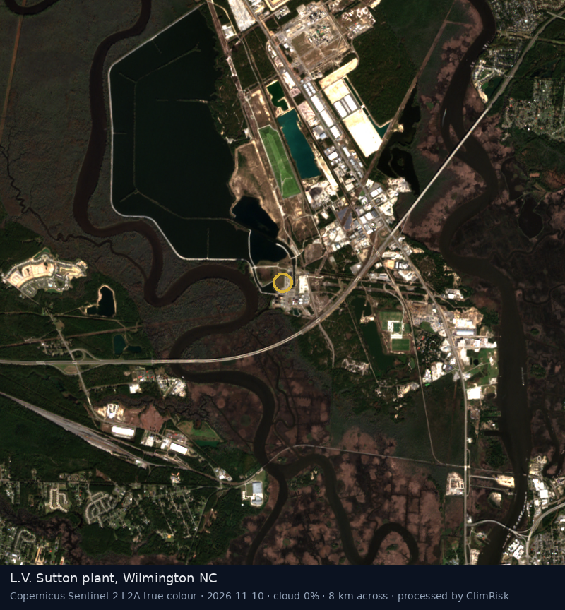
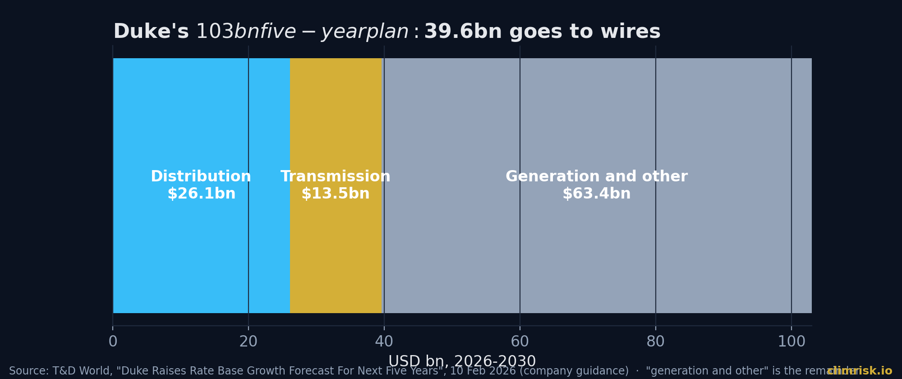
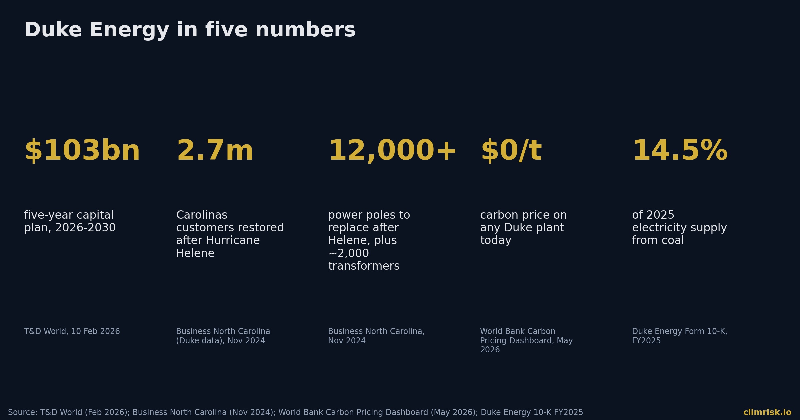
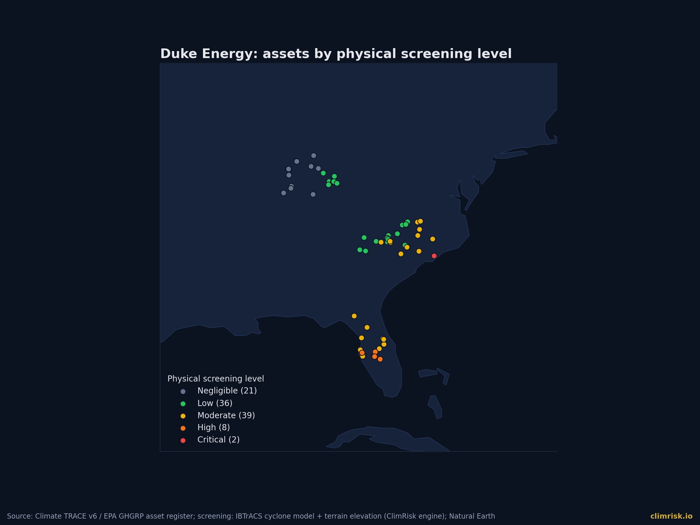
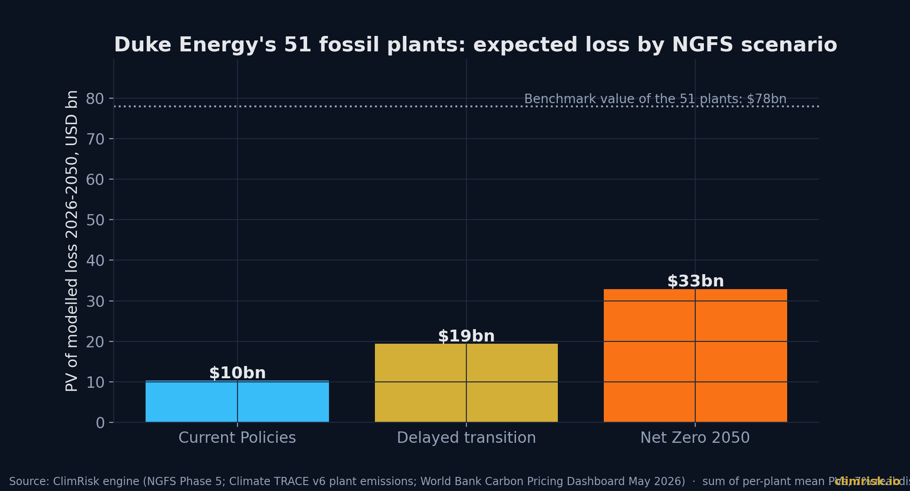
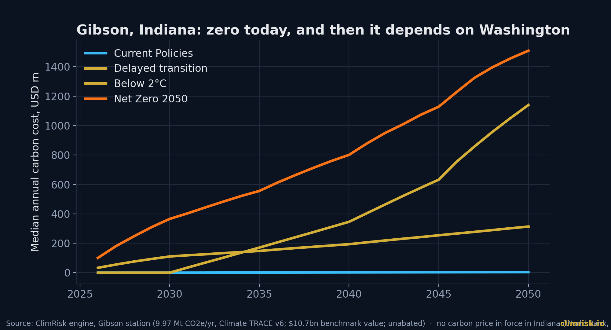
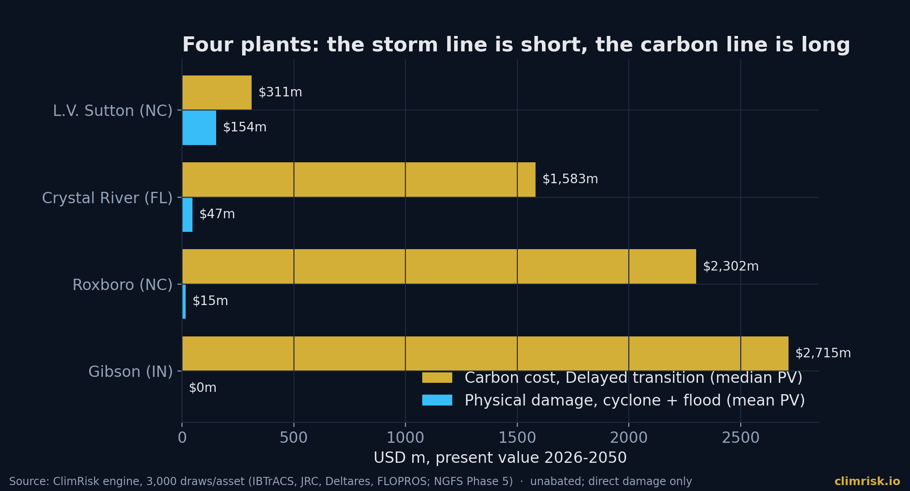
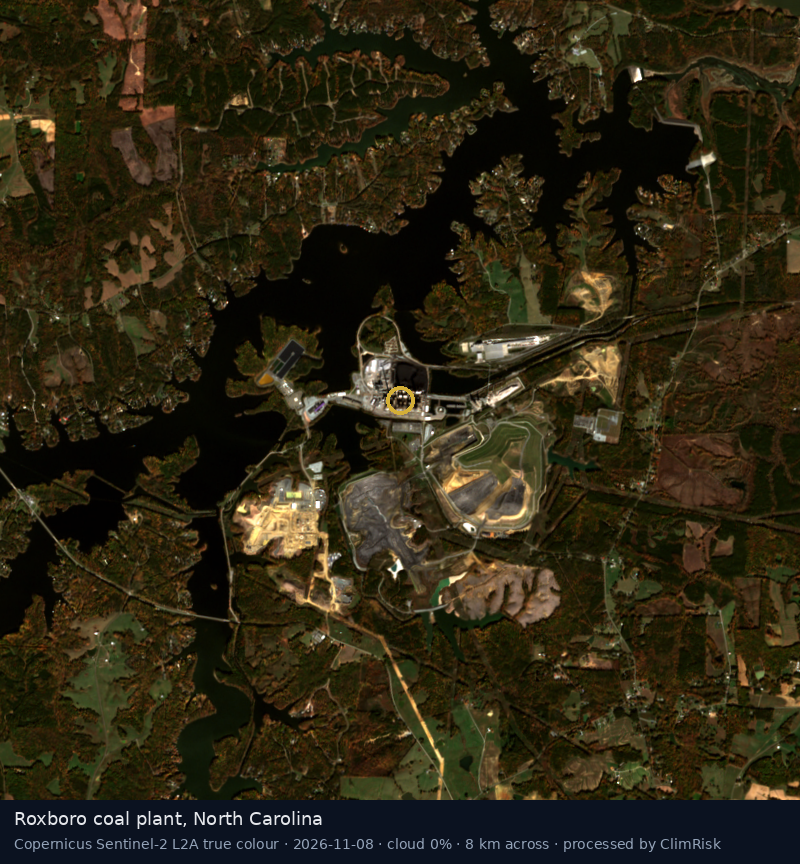

On 5 November 2026, Duke Energy reported third-quarter earnings of $1.99 a share, up from $1.81 a year earlier, and narrowed its full-year guidance to $6.70 to $6.80. **[Business News Today 2026]** Part of the lift, the company said, came from favourable weather. For a utility that serves about 8.7 million electricity customers, that phrase does a lot of work. **[Duke 10-K 2025]**

Two years ago the weather was not favourable. Hurricane Helene tore through the Carolinas in late September 2024, and Duke restored power to 2.7 million customers there, more than 1.4 million of them in North Carolina. **[Business North Carolina 2024]** The rebuild meant replacing about 2,000 transformers and more than 12,000 power poles.

So which is Duke's climate risk: the storm, or the carbon? We ran its register plants through the ClimRisk engine. The answer is both, but they sit in different places. The storm hits the wires. The carbon sits in the stack. And for a regulated utility, both end up in the same place: the customer bill and the rate case.

## A $103 billion bet on the grid

Duke is building. In February 2026 it set its five-year capital plan for 2026 to 2030 at about $103 billion and forecast rate base growth averaging 9.6% a year, from about $114 billion in 2025 to about $180 billion in 2030. **[T&D World 2026]** Of that plan, nearly $13.5 billion goes to transmission and more than $26.1 billion to distribution.

The generation side is mixed. In 2025, 33.5% of the electricity Duke's utilities supplied came from gas and oil, 27.5% from nuclear and 14.5% from coal, with another 22.5% purchased. **[Duke 10-K 2025]** Its October 2025 Carolinas resource plan adds about 9.7 GW of gas by 2033 and more than 1.1 GW of new nuclear by 2037, and proposes two- to four-year extensions for the coal units at Belews Creek, Cliffside and Marshall. **[POWER 2025]** A state law removed the requirement to cut carbon emissions 70% by 2030.

The federal backdrop moved too. The previous EPA had proposed rules that would have required coal plants running beyond 2032 to co-fire at least 40% gas by 2030. The current EPA has proposed rolling them back entirely, arguing this would save customers more than $1 billion a year nationally. **[WFAE 2025]** WFAE reported that Duke cited the proposed rollback as key to its plan to run the coal units longer.

## The weather bill: real, but mostly in the wires

Start with the storm. Duke's own filing is direct about what weather does to its cash flows.

> **SOURCE — Duke Energy Form 10-K, FY2025:** "Delays between expenditures and cost recovery for restoration and rebuild activities after significant storms can also adversely impact the timing of cash flows"

The recovery numbers show how that works. In Florida, Duke asked regulators in December 2024 to recover about $1.1 billion in direct costs from hurricanes Debby, Helene and Milton, adding about $21 per 1,000 kWh to residential bills. **[Reuters 2024]** In North Carolina, Duke Energy Carolinas and Duke Energy Progress sought storm recovery bonds for Zeta, Izzy, Ian, Debby and Helene, with a proposed size of $1.2 to $1.5 billion as of April 2025. **[Acme News 2025]** In South Carolina, regulators approved a securitisation that Duke says saves customers more than $140 million on Helene costs, with a storm charge of about $4.58 a month, or 3.2%, for a typical household. **[Duke Energy 2026]**

Notice what is being recovered. It is not power stations. It is poles, transformers and lines, plus the crews to fix them.

That matters for how a screen like ours reads Duke. The ClimRisk engine models direct damage at plant locations. We screened 51 fossil generating plants in the Climate TRACE register, which together emit about 92 million tonnes of CO2e a year. Their combined modelled average annual damage from cyclones and floods is about $48 million on a benchmark value of $78 billion. That is under 0.1% a year.

The exposure is concentrated on the coast. The L.V. Sutton gas plant near Wilmington, North Carolina is the most exposed plant we screened. The engine counts 0.89 tropical-storm-force events a year within reach of the site since 1980, with a 1-in-100-year wind of 71 m/s, Category 5 strength. The worst event in the record is Hurricane Fran in 1996, which passed 13 km away and which the model puts at Category 3 strength at the site. Modelled average annual damage is 1.28% of value, about $13 million a year, and the present value of physical loss to 2050 has a mean of $154 million and a 95th percentile of $427 million.

Inland, the picture flattens. Roxboro in North Carolina screens at 0.02% a year. Gibson in Indiana, Duke's largest single emitter in the register, screens at zero.

So the plant screen says the storm risk is modest. Helene says it is not. Both are true. The difference is the distribution network, which no plant-level model sees, and which is where Duke is spending $26 billion.

## The carbon bill: zero today, large later

Now the stack. No carbon price applies to any Duke plant today. The World Bank's dashboard shows no instrument covering power in North Carolina, Indiana or Florida. **[World Bank 2026]** In 2026 the carbon cost is zero.

The NGFS scenarios disagree about how long that lasts. Under Current Policies, the US shadow price stays near zero. Duke's 51 plants still carry a mean modelled loss of about $10 billion in present value to 2050, driven by the minority of draws in which policy tightens anyway; storms add only about $48 million a year. Under a Delayed transition, the price stays at zero through 2030 and then rises fast, to about $285 a tonne by 2040. The mean loss rises to about $19 billion. Under Net Zero 2050, it reaches about $33 billion, against $78 billion of benchmark value.

These are means across Monte Carlo draws. The spread inside each scenario is wide, because the engine samples how much of the shadow price actually reaches a plant.

Take Gibson, a coal station in Indiana that Climate TRACE puts at about 10 million tonnes of CO2e a year. On a $10.7 billion benchmark value, the engine's Delayed transition result is a median loss of $2.7 billion to 2050, with a 95th percentile of $9.1 billion. Under Current Policies the median is about $10 million. The annual cost path shows why: zero until 2030, then about $346 million a year by 2040 if emissions are unabated.

Roxboro, the North Carolina coal plant, follows the same shape: a Delayed transition median of $2.3 billion and a 95th percentile of $7.6 billion on an $8.2 billion benchmark value. At Crystal River in Florida the Delayed transition median is $1.7 billion, and the 95th percentile reaches the full $4.1 billion benchmark value of the plant.

Put the two lines side by side and the ratio is stark. Even at Sutton, the most storm-exposed plant, the median carbon cost under a Delayed transition is about twice the mean physical loss. At Crystal River it is about 34 times larger, at Roxboro about 150 times, and Gibson has no modelled physical loss at all.

## Why a regulated utility is different

For a steelmaker, a carbon cost is a margin problem. For Duke, it is mostly a recovery problem.

A regulated utility earns a return on the capital regulators allow into its rate base. If a carbon price arrives, the cost of running Gibson or Roxboro rises, and Duke would ask to pass it through, as it passes through fuel and storm costs today. Our model assumes no pass-through, so the figures above are a gross exposure, not a hit to earnings.

That does not make them harmless. Three channels matter.

The first is affordability. The Carolinas plan was filed with an estimated bill increase of 2.1% a year over ten years before any carbon cost. **[POWER 2025]** Storm charges are already on bills, or proposed, in all three states we looked at. Regulators who must approve a $103 billion programme have a limit on what they will add.

The second is timing. Duke's 10-K warns that delays in storm cost recovery hit cash flows. A carbon price arriving in the early 2030s, as in the Delayed transition, would land in the middle of the heaviest capex years, when leverage is already stretched by the build.

The third is stranding. Running coal plants two to four years longer adds to the emissions that would face a price if one came. Under Net Zero 2050 the engine closes about a quarter of Gibson and Roxboro draws early. A plant in the rate base that regulators later judge imprudent to have kept running is the kind of asset that does not get recovered in full.

## What investors, lenders and operators should do

Equity and credit investors should split Duke's climate risk into two lines. The weather line is about the grid: storm frequency in the Southeast, the speed of securitisation, and how much of the $39.6 billion of wires capex is hardening. The carbon line is about the coal fleet's retirement dates and the policy path after 2030.

Lenders to the operating companies should treat retirement dates as covenants in disguise. Ask which plants are now planned to run past 2032, and what the recovery assumption is if a federal price returns.

Operators and regulators should look past the plant screen. A model that sees only power stations will tell you Duke's physical risk is small. Helene showed that the risk is in thousands of kilometres of line. That needs a network model.

## Where the numbers are soft

These are costs of inaction, with emissions unabated and no pass-through to customers. Asset values are benchmarks. Plant emissions are Climate TRACE estimates, not company figures. The register lists many Duke plants twice, once from Climate TRACE and once from EPA's GHGRP. The raw company run over all 106 entries double-counts, so we report the 51 Climate TRACE generation plants only. Zero-emission nuclear and hydro plants are not in that set, so the value base understates Duke's fleet. River flood depths could not be read for any plant, so physical loss is a lower bound. Cyclone frequencies are historical, with no climate-change uplift. The portfolio run (shared transition draws across plants) and the single-plant runs (3,000 independent draws) differ most under Current Policies: the portfolio run gives Gibson a mean of $1.9 billion, the single-plant run a mean of $190 million and a median of $10 million. Treat the $10 billion portfolio figure for Current Policies as an upper estimate. The Q3 2026 figures are from a press summary of Duke's release.

## How ClimRisk measured this

ClimRisk ran Duke Energy's register assets through its four-stage Risk Analyst: physical hazards with flood defences (IBTrACS cyclone tracks, JRC river and Deltares coastal flood maps, FLOPROS protection standards), carbon-pricing policies in force (World Bank Carbon Pricing Dashboard, May 2026), NGFS Phase 5 transition scenarios (IIASA), and a Monte Carlo loss distribution for 2026 to 2050, discounted at 7% real. The portfolio figures sum the mean present values of 51 Climate TRACE generation plants. Gibson, Roxboro, Crystal River and L.V. Sutton were run individually with 3,000 draws each. Figures are screening-grade; validate asset values and emissions with the owner before decisions. ClimRisk is not investment advice.
