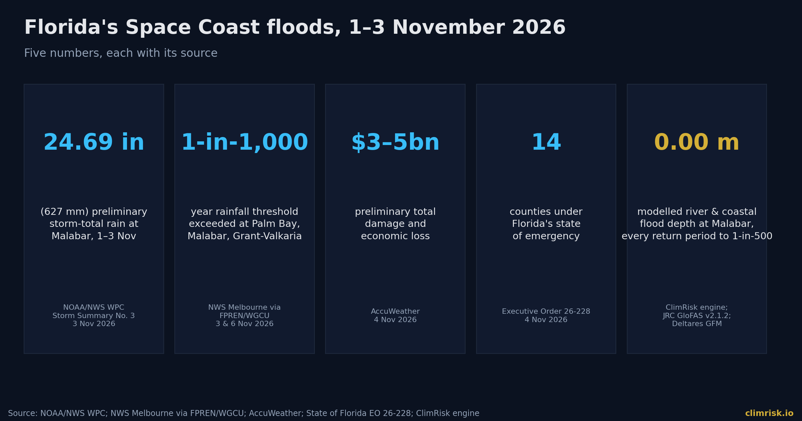
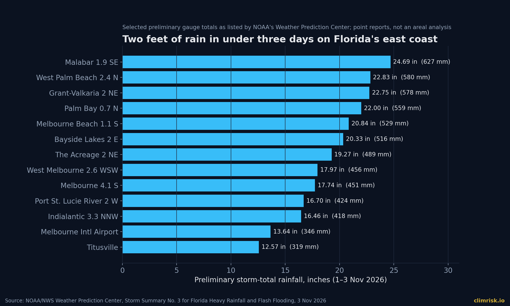
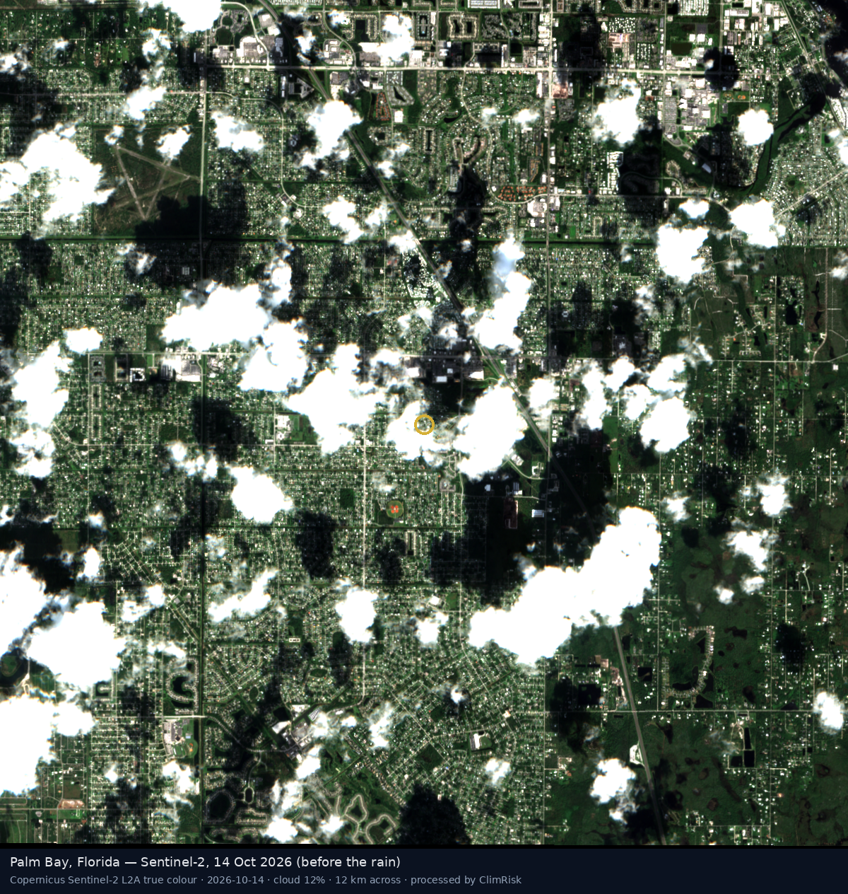
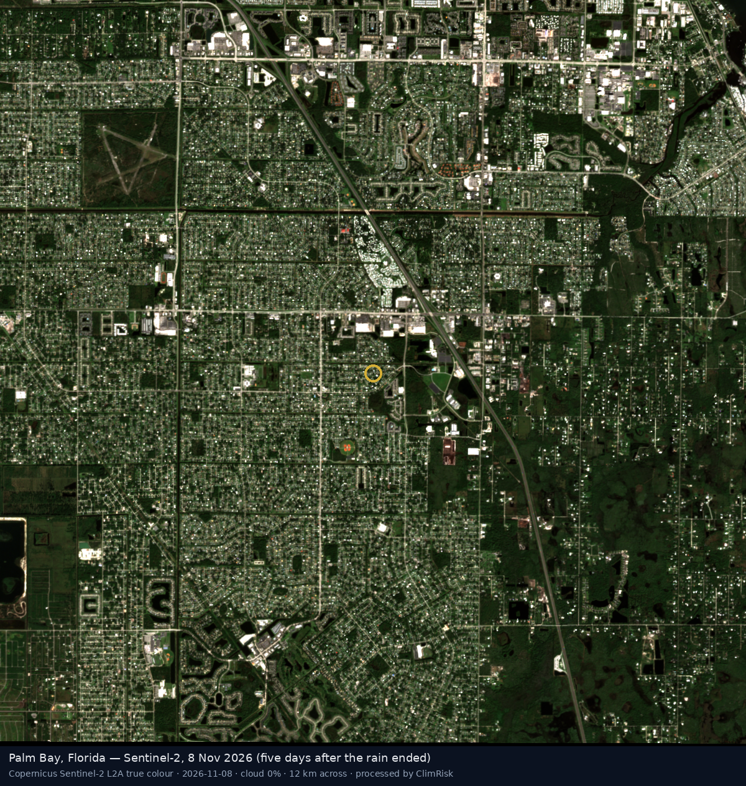
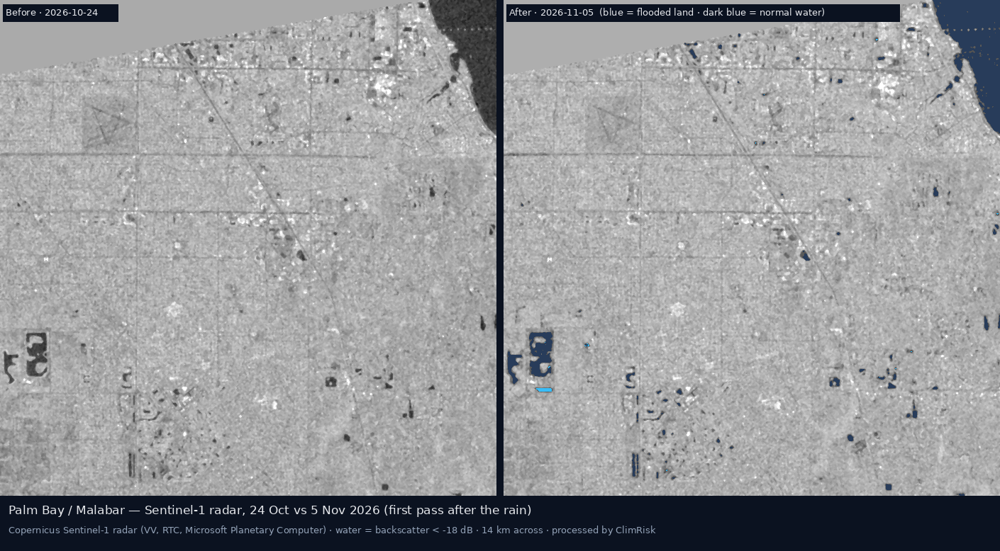
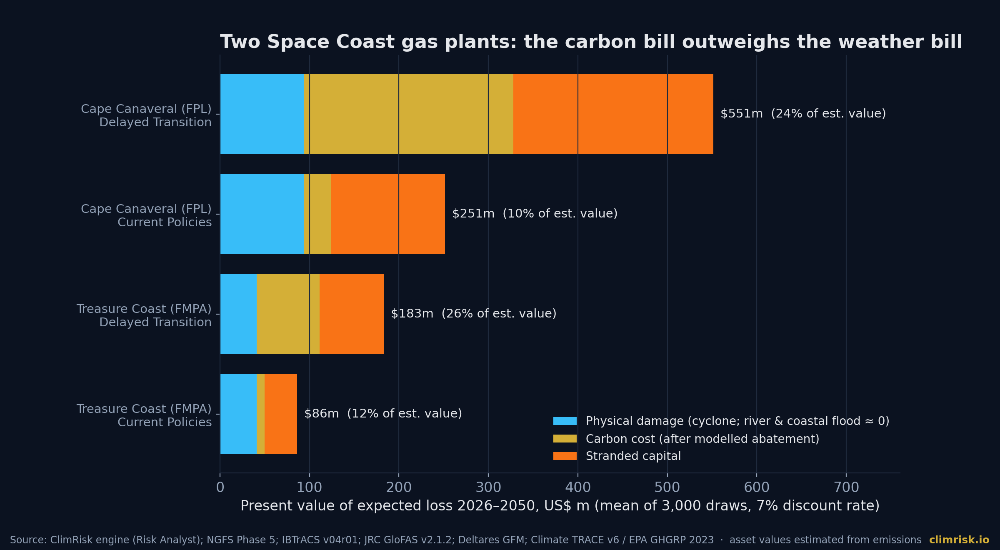

At 7:56 a.m. on Monday 2 November 2026, the National Weather Service office in Melbourne, Florida, issued a Flash Flood Emergency for West Melbourne and Palm Bay. **\[The Watchers 2026\]** By then rain had been falling since early Sunday. Between 6 and 10 a.m. that Monday, a gauge in Valkaria caught 11.32 inches. **\[Washington Post 2026\]** By Tuesday evening NOAA's Weather Prediction Center listed a preliminary storm total of 24.69 inches (627 mm) near Malabar and 22.00 inches near Palm Bay. **\[NOAA WPC 2026\]** AccuWeather later put three-day totals at 28.93 inches in Malabar and 28.13 inches in Palm Bay. **\[AccuWeather 2026\]**

Two people died in the Palm Bay area. **\[AccuWeather 2026\]** Florida's governor declared a state of emergency on 2 November and widened it to 14 counties two days later. **\[State of Florida EO 26-228, 2026\]** AccuWeather's preliminary estimate of total damage and economic loss is $3 billion to $5 billion. **\[AccuWeather 2026\]**

Then we ran the ClimRisk engine at Malabar. It shows a modelled river-flood depth of zero at every return period up to 1-in-500 years, and a coastal-flood depth of zero to 2050. This piece is about that gap. It is not a bug in one model. Most physical-risk screening reads the same global river and coastal flood maps, and a storm like this one sits outside them.

## The Storm: Rain, Not Wind

This was not a hurricane. No named storm made landfall. The damage came from rain that fell faster than the ground, the canals and the creeks could carry it away.

The rates were extreme. The Washington Post reported rain rates above 4 inches an hour at times. It also reported radar estimates of up to 28 inches along parts of the Space Coast in a day and a half, which it put at "more than 1-in-1,000 years in some areas." **\[Washington Post 2026\]** Gauges agree on the order of magnitude. In the WPC's selected list of preliminary totals, six Florida gauges topped 20 inches. **\[NOAA WPC 2026\]**

> **SOURCE — FPREN / WGCU, 3 November 2026:** Palm Bay, Malabar and Grant-Valkaria "experienced rainfall exceeding the threshold for a 1-in-1,000-year event."

A 1-in-1,000-year label describes rainfall depth at a point over a set duration. It does not mean the flood that followed was a 1-in-1,000-year flood everywhere, and it does not say this cannot happen again soon. It says that, on the historical record, rain this heavy at these gauges is very rare.

The science on trend is clear, even if attribution of this one storm is not our claim to make.

> **SOURCE — IPCC AR6 WGI, Summary for Policymakers (2021), A.3.1:** "The frequency and intensity of heavy precipitation events have increased since the 1950s over most land area for which observational data are sufficient for trend analysis (high confidence)."

## What the Water Did

The damage pattern was that of a flash flood in a flat, built-up landscape. Turkey Creek overflowed and washed out bridges, and Port Malabar Boulevard was under water. **\[Cotality 2026\]** A water-main break on Port Malabar Boulevard cut supply to part of Palm Bay, and Melbourne put all of its water customers on a precautionary boil-water notice. **\[The Watchers 2026\]** The Florida Fish and Wildlife Conservation Commission carried out more than 60 rescues. All Brevard Public Schools campuses closed on 2 and 3 November. **\[The Watchers 2026\]** More than 200,000 residents of Melbourne, West Melbourne and Palm Bay were at risk of life-threatening flash flooding on 2 November. **\[FPREN/WGCU 2026\]**

The water also moves on. The governor's amended order cites an NWS forecast of minor to moderate flooding on the St. Johns River that could last several weeks. **\[State of Florida EO 26-228, 2026\]**

We looked from space. Sentinel-2's optical camera was clouded out until 8 November, five days after the rain ended. By then the Palm Bay grid looks much as it did in October.

Radar sees through cloud, but the first Sentinel-1 pass after the storm was on 5 November. Comparing it with a 24 October pass over a 14 km frame, ClimRisk's water mask found about 0.05 km² of new open water.

That small number is the point, not a contradiction. Flash floods in suburbs rise and fall within hours or days. Water under tree canopy or between houses is hard for radar to see. A satellite that arrives three days late records a dry town that was under water. This is one reason rain-driven flooding is under-represented in the data that risk models are built on.

## Who and What Is Exposed

Southern Brevard is a residential and light-industrial area, not a heavy-industry corridor. The ClimRisk asset register, which is built from Climate TRACE and the US EPA's greenhouse gas reporting programme, holds 29 facility records in the area between Orlando and Stuart. Three are useful tests here:

- **A Palm Bay industrial site** at the location the register gives for Renesas Electronics America, a few kilometres north of the heaviest gauges. The register has no value for it, so we ran the engine per $100m of asset value.
- **Cape Canaveral Clean Energy Center**, Florida Power & Light's gas plant on the Indian River, 2.52 Mt CO₂e a year in EPA reporting.
- **Treasure Coast Energy Center**, the Florida Municipal Power Agency's gas plant near Fort Pierce, 0.76 Mt CO₂e a year.

We have no report of damage at any of these sites, and we do not suggest there was any. We use them to ask a narrower question: what would a standard climate-risk screen have told an investor about them before 1 November?

## What the ClimRisk Engine Says

At Palm Bay, the engine's hazard layers say three things. Cyclones are a real and frequent threat: 52 storms have passed within 200 km since 1980, and the modelled 1-in-100-year wind is 55.8 m/s, a Category 3. River flood, read from the JRC global river flood maps, is zero at every return period from 1-in-10 to 1-in-500. Coastal flood, read from Deltares' global maps, is zero at every return period to 1-in-250, today and in 2050. **\[ClimRisk engine 2026\]**

So the engine prices the Palm Bay site as a cyclone risk and nothing else. Per $100m of asset value, the present value of expected physical loss from 2026 to 2050 is $4.8m on average, with a median of $2.6m and a 95th percentile of $17.0m. The modelled average annual damage is 0.41% of value, all of it from wind. **\[ClimRisk engine 2026\]**

That number is defensible for what it covers. It is silent about the hazard that actually arrived. A 1-in-1,000-year rainfall event hit a place where our flood layers show no flood.

The two gas plants tell a second story, one that readers of our earlier pieces will recognise. For both, flood again contributes essentially nothing. Cape Canaveral sits near water, and its coastal depth reaches only 0.04 m at the 1-in-100 level in 2050. Cyclone damage is modest. The carbon price is what moves the numbers. No carbon price applies to Florida power plants today. **\[World Bank Carbon Pricing Dashboard 2026\]** Under the NGFS Phase 5 Delayed Transition scenario, one arrives in the 2030s.

At Cape Canaveral, under Delayed Transition, the engine's mean loss to 2050 is $551m, or 24% of an estimated $1.71bn value. The 95th percentile is $1.14bn. Physical damage is $94m of the mean, the carbon bill after modelled abatement is $234m, and stranded capital is $223m. If the plant does nothing to abate, the carbon cost alone is $289m. Under Current Policies, the mean falls to $251m (10%), with a median of $113m. **\[ClimRisk engine 2026\]**

At Treasure Coast, the Delayed Transition mean is $183m (26% of an estimated $517m), with a 95th percentile of $383m. Under Current Policies it is $86m (12%). **\[ClimRisk engine 2026\]**

These plant values are estimated from emissions, because the register has no capacity-based value for them. The percentages are indicative. The direction is not: for gas generation on this coast, policy risk outweighs weather risk by a wide margin in every transition scenario we ran.

## How the Loss Reaches Balance Sheets

For the residential and small-business exposure that dominated this event, the transmission runs through insurance gaps. Standard homeowners' policies exclude flood. **\[Cotality 2026\]** Aon's early view was a loss of hundreds of millions of dollars, possibly higher, with the insured share "a fraction" of the total. **\[Business Insurance 2026\]** The gap between that insured view and AccuWeather's $3–5bn total-loss view is where the cost lands on households, municipalities, small firms and their lenders.

For listed companies and lenders, four pathways matter.

1. **Business interruption.** School, transit and office closures across several counties are a reminder that sites stay dry but staff cannot reach them. Our engine prices direct damage only. Interruption is not in the numbers above.
2. **Local infrastructure.** Washed-out bridges, a burst water main and a citywide boil-water notice are municipal costs. They show up in municipal credit and in the services firms depend on.
3. **Mortgage and small-business credit.** Uninsured flood damage outside mapped zones is a credit event for borrowers who did not think they were at risk.
4. **Model risk.** If a portfolio's physical-risk score depends on river and coastal layers alone, this event did not happen as far as the score is concerned.

## What Investors, Lenders and Operators Should Do

First, ask which flood types a climate-risk number covers. "Flood" in a vendor report often means river and coastal flood. Ask directly whether surface-water (pluvial) flooding is included, and at what resolution.

Second, treat a zero flood score in a flat, built-up, low-lying area as "not assessed", not "no risk." Southern Brevard has the profile: flat terrain, dense suburban drainage and intense convective rain.

Third, for operators, go below the model. Ask for site drainage capacity, floor levels relative to the surrounding streets, and access routes. A plant can be dry while its staff and suppliers are cut off.

Fourth, for Florida gas generation, keep the carbon question on the table. In our runs it is the larger number by far, even in a week when the headlines were about water.

## Method and Limitations

The cyclone model uses NOAA IBTrACS v04r01 tracks since 1980 with a Holland (1980) wind profile; frequencies are historical, with no climate-change uplift. River flood depths are from the JRC CEMS-GloFAS global maps v2.1.2 (undefended). Coastal depths are from Deltares Global Flood Maps v2021.06, including sea-level rise to 2050. FLOPROS assigns Florida a 1-in-500 design standard for both river and coastal defences, a policy-layer value we have not verified on the ground. None of these layers model surface-water flooding from intense local rain, which caused this event. Asset values for the two plants are estimated from emissions; the Palm Bay run uses a nominal $100m. Direct physical damage only. Rainfall figures are preliminary point reports and differ by source, window and method; we quote each with its source. The Sentinel-1 water mask uses a −18 dB backscatter threshold and is a screening product.

## How ClimRisk Measured This

We ran the ClimRisk engine's hazard screen at Palm Bay and Malabar, and its full four-stage Risk Analyst on three sites from our asset register: physical hazards with flood defences, carbon-pricing instruments in force (World Bank dashboard), NGFS Phase 5 transition scenarios, and a Monte Carlo loss distribution with 3,000 draws, a 7% discount rate and emissions unabated unless stated. Values are present values for 2026–2050 in US dollars; we report means, medians and 95th percentiles. Satellite scenes are real Copernicus Sentinel-1 and Sentinel-2 data processed by ClimRisk. The result we most want readers to take away is the one our own engine got wrong: a 1-in-1,000-year rainfall event in a place our flood maps call dry.
