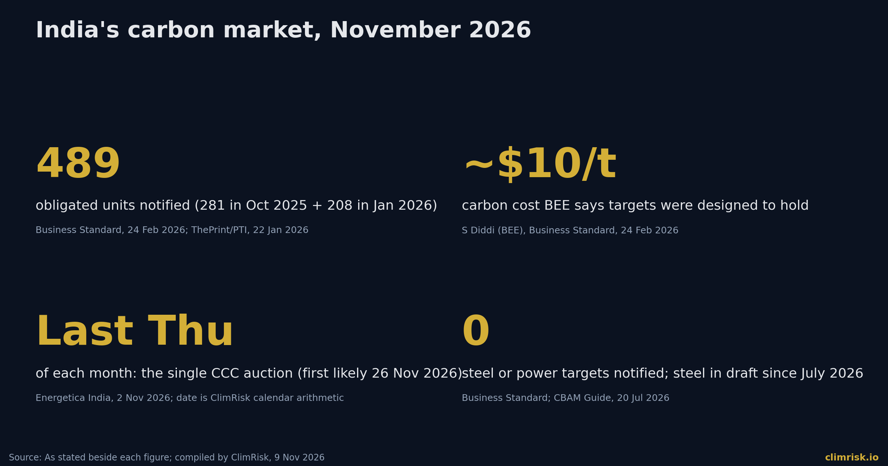
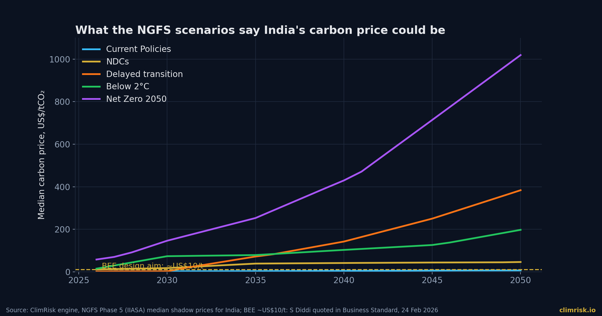
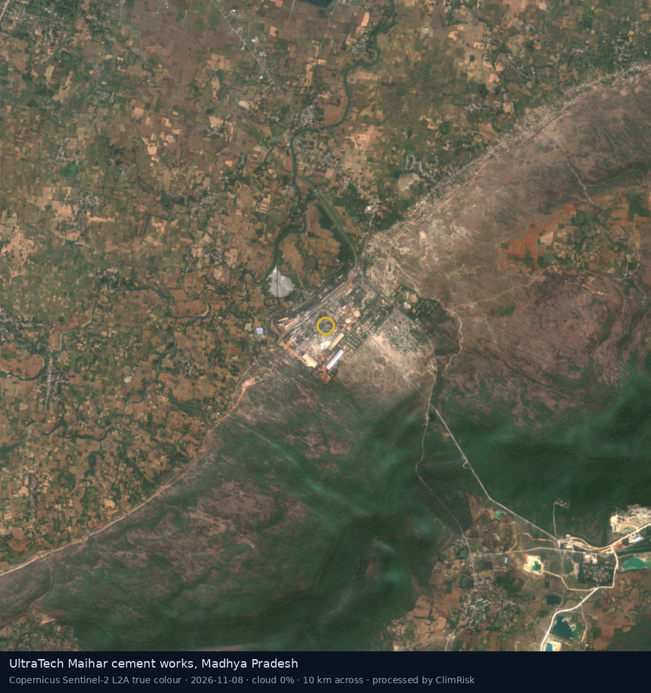
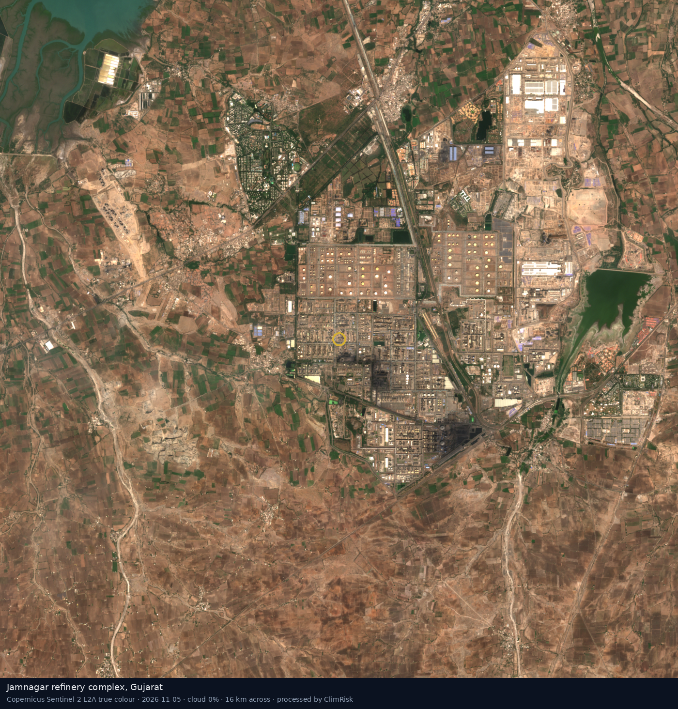
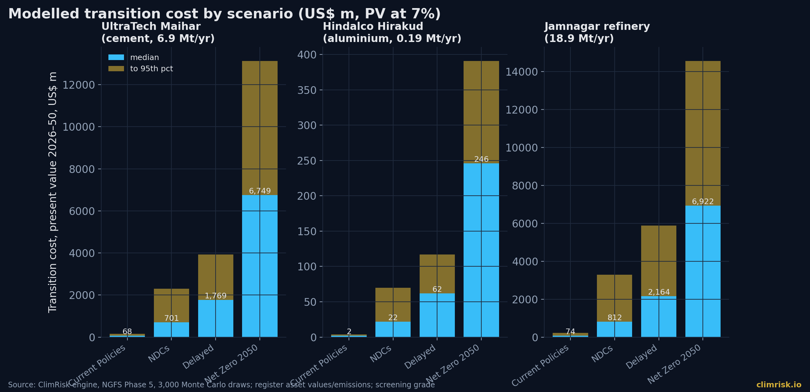

On 3 March 2026, India's gazette carried the rules for a market that did not yet exist. The Central Electricity Regulatory Commission's regulations on the purchase and sale of carbon credit certificates had been notified on 27 February **[Mondaq 2026]**. On 2 November, a trading procedure followed: certificates will change hands in a single closed auction on the last Thursday of every month, with the bidding window running from noon to 2 p.m. **[Energetica India 2026]**. By our calendar, the first possible session is Thursday 26 November.

As of today we found no report of an executed trade, a clearing price or a volume. The certificates themselves were expected to be issued this month, with trading between November and January **[Bar & Bench 2026]**. India's carbon market is, in other words, days to weeks from opening, and almost nobody outside its 489 obligated units has priced it.

This article asks the question a lender should ask before the first auction: what is this scheme worth to a plant, and what could it become?

## What India actually built

The Carbon Credit Trading Scheme is an intensity scheme. It does not cap tonnes. Each obligated plant gets a target for emissions per unit of output, measured against its own baseline year, and either beats it and earns tradable certificates, or misses it and must buy them **[ICAP 2026]**. Phase one covers two compliance years, FY2025-26 and FY2026-27, against a FY2023-24 baseline **[Saraf Partners 2026; ICAP 2025]**.

The coverage has come in two steps. On 8 October 2025, 281 units in aluminium, cement, chlor-alkali and pulp and paper were notified. On 13 January 2026, a further 208 in secondary aluminium, refineries, petrochemicals and textiles followed **[Business Standard 2026; ThePrint 2026]**. The ICAP emissions trading registry puts the intensity-reduction requirements at between 2.8% and 7.06% for aluminium, 3.3% to 11% for chlor-alkali and up to 15% for pulp and paper **[ICAP 2025]**.

Two things are missing, and they are the two biggest. Power, India's largest emitting sector, is outside the scheme **[Business Standard 2026]**. And steel has no notified target: its director said on 3 July that draft targets had gone out for consultation **[CBAM Guide 2026]**. Not every source agrees. One law-firm summary lists power generation and steel among obligated sectors **[Mondaq 2026]**. We have followed the reporting that cites the notifications themselves, and we flag the conflict because a credit model built on the wrong sector list will be wrong.

> **SOURCE — Business Standard, 24 February 2026:** the power sector, "India's biggest overall polluter, is not part of the scheme".

## Why the price is the point

An intensity target is a soft price signal. A plant that is 3% above its target buys 3% of its output's worth of certificates, not a charge on every tonne. Our engine models this: for a benchmark-style system, it treats only 10% of emissions as effectively charged (range 5% to 25%).

What matters then is how hard the target is and what the certificate costs. On the second question, the official signal is low. BEE's Saurabh Diddi told Business Standard that targets were designed to keep carbon costs "around $10 per tonne"; an Aditya Birla executive said committees hesitate once carbon passes $20 **[Business Standard 2026]**. The CERC regulations provide for a floor and a "forbearance" ceiling on certificate prices. We could not find the numbers in any source we read.

Enforcement is real but modest. After more than three defaults in a quarter, an entity can be barred from dealing in certificates for six months, in addition to penalties under the Energy Conservation Act **[Energetica India 2026]**. ICAP additionally reports an environmental compensation of twice the average certificate price, though we found it in only one source **[ICAP 2026]**.

## What the NGFS scenarios say the price could be

The ClimRisk engine reads India's carbon price from the NGFS Phase 5 scenarios. The medians are not forecasts. They show how far an intensity scheme priced near US$10 sits from the paths that would meet climate targets.

In 2030, the median is about US$2 a tonne under Current Policies, US$17 under NDCs, US$73 under Below 2°C and US$146 under Net Zero 2050. By 2040 those become US$4, US$41, US$103 and US$430. Delayed transition is the awkward one: about US$2 in 2030 and then US$142 by 2040, because late action means a steep catch-up **[ClimRisk engine, NGFS Phase 5]**.

So the opening price, if BEE's aim holds, sits between Current Policies and NDCs. The investment question is not what a certificate costs in 2027. It is whether the scheme is a first step on one of the steeper paths.

## Three plants from the register

We ran three plants from the ClimRisk asset register through the four-stage Risk Analyst. Emissions and asset values are register estimates, held at today's level and screening-grade.

| Plant | Sector | Direct CO₂ (Mt/yr) | Asset value (USD) |
|---|---|---|---|
| UltraTech Maihar, Madhya Pradesh | Cement | 6.9 | 1.32bn |
| Hindalco Hirakud smelter, Odisha | Aluminium | 0.19 | 0.48bn |
| Reliance Jamnagar refinery, Gujarat | Refining | 18.9 | 18.8bn |

Weather is a footnote. Maihar shows no modelled physical loss. Hirakud's average annual cyclone damage is 0.00007% of asset value. Jamnagar, on the Gujarat coast, is the only one with a meaningful figure: average annual damage of about 0.06% of value, or US$12 million a year, with a 1-in-100-year loss of about US$125 million **[ClimRisk engine; IBTrACS; FLOPROS]**. River-flood maps could not be read at Hirakud or Jamnagar, so physical figures there are lower bounds.

The carbon column is a different order of magnitude. The table shows the median present value, 2026 to 2050, of modelled transition cost, with the 95th percentile in brackets, at a 7% real discount rate and 3,000 Monte Carlo draws.

| Scenario | Maihar (US$ m) | Hirakud (US$ m) | Jamnagar (US$ m) |
|---|---|---|---|
| Current Policies | 68 (151) | 2 (4) | 74 (216) |
| NDCs | 701 (2,294) | 22 (70) | 812 (3,294) |
| Delayed transition | 1,769 (3,922) | 62 (117) | 2,164 (5,882) |
| Net Zero 2050 | 6,749 (13,131) | 246 (391) | 6,922 (14,557) |

Three readings matter. First, under Current Policies, which is closest to what India has actually legislated, the cost is small: about 5% of Maihar's asset value and under 1% of Jamnagar's. A lender can ignore it today. Second, the spread between Current Policies and Delayed transition is a factor of 26 at Maihar and 29 at Jamnagar. Same plant, same emissions, the only variable is policy. Third, Net Zero 2050 exceeds Maihar's whole asset value, a result the engine reads as a closure signal rather than a bill: it closes the plant in 99% of draws **[ClimRisk engine]**.

Cement is the sharpest case. Process emissions from limestone cannot be switched away by a cleaner fuel, so an intensity target that tightens each year turns into a capital-expenditure decision: kiln efficiency, clinker substitution, then capture.

## The EU link

There is a second reason this market matters, which is Brussels. As of 20 July 2026, the CCTS was not recognised under Article 9 of the EU's CBAM, which lets exporters deduct a carbon price paid at home. Negotiations with the EU were ongoing and no agreement had been announced **[CBAM Guide 2026]**. For an exporter of steel or aluminium to Europe, a domestic price near US$10 is worth little against a CBAM certificate price of 82.32 euros a tonne for Q3 2026 **[SteelOrbis 2026]**, but a recognised scheme at any price is better than none.

## What investors, lenders and operators should do

**Treat the scheme as an option, not a cost.** At about US$10 a tonne, with 10% of emissions charged, the direct bill is small. The value lies in how fast targets tighten once steel and power enter the system.

**Ask for the plant-level intensity baseline.** Each obligated unit has a FY2023-24 baseline and two annual targets. A credit analyst can ask a borrower whether it will earn or buy certificates in FY2026-27, and by how much.

**Stress-test three scenarios, not one.** Current Policies, NDCs and Delayed transition are all plausible, and the cost differs by more than an order of magnitude.

**Watch four dates.** The first auction and clearing price, expected from 26 November. The steel targets. A decision on power. And EU recognition under CBAM.

## Method and limitations

Facts on the scheme come from the secondary sources cited; we could not retrieve the BEE, MoEFCC or PIB notifications themselves, and sources disagree on several details (the date of the January notification, the sector list, cement ranges). We have used only figures that two sources agree on, or flagged them. The engine's policy module still lists steel among sectors with targets, which reporting contradicts, and it carries no certificate price because none exists.

## How ClimRisk measured this

We ran the ClimRisk Risk Analyst on three register assets: physical hazards from IBTrACS, JRC and Deltares flood maps and FLOPROS defences; policy from the World Bank carbon pricing dashboard; transition from NGFS Phase 5 scenarios as run by IIASA; and a 3,000-draw Monte Carlo of losses to 2050. Results are screening-grade: present values at a 7% real discount rate, emissions unabated at today's level, and asset values from the register. Please validate with the owner before any decision.
