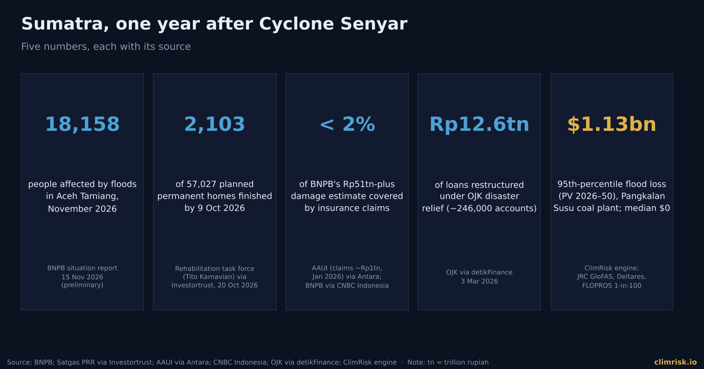
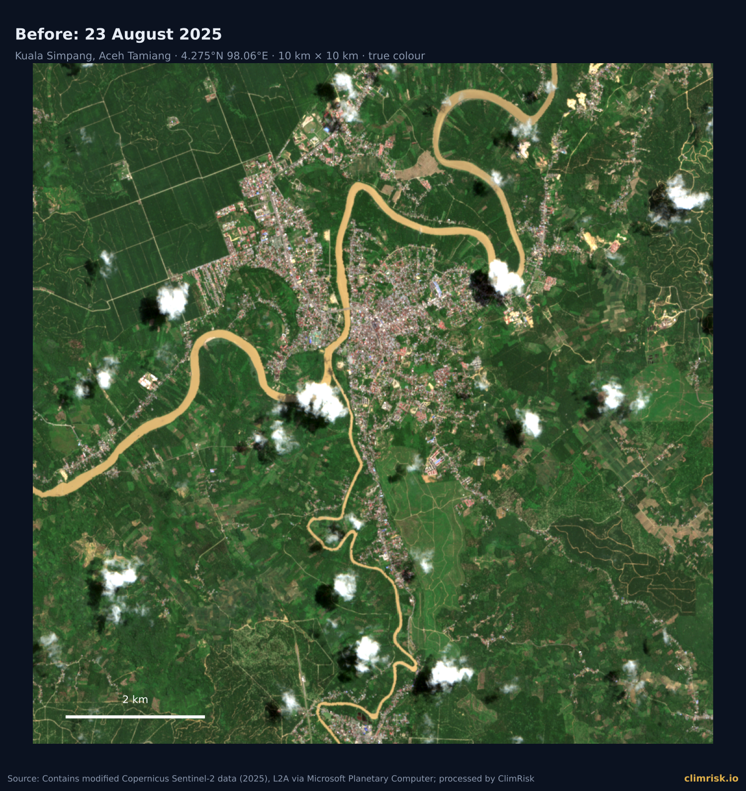
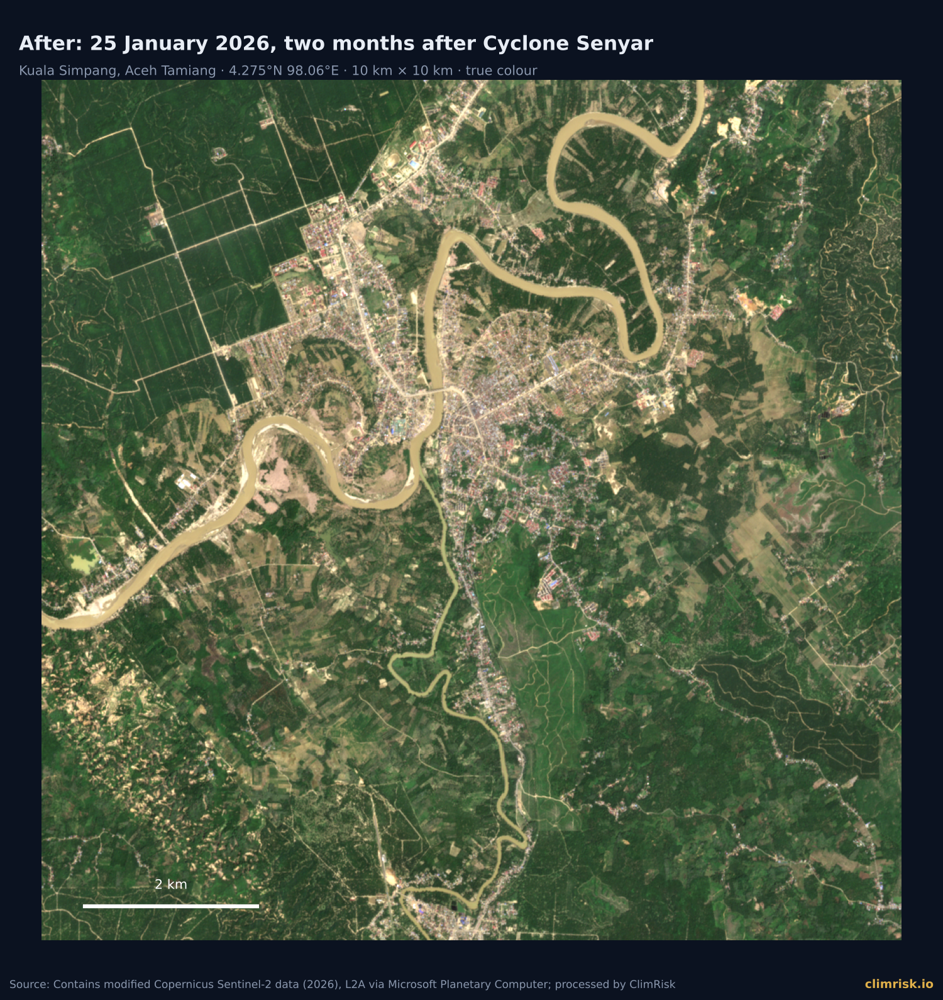
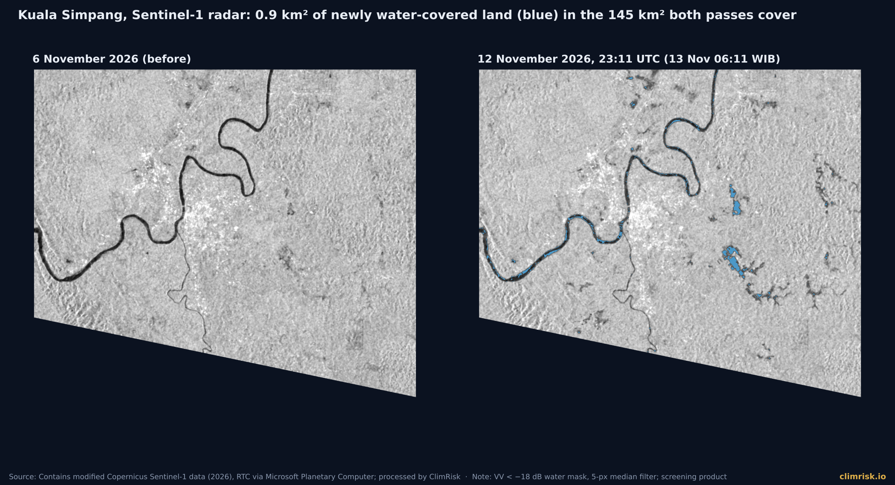
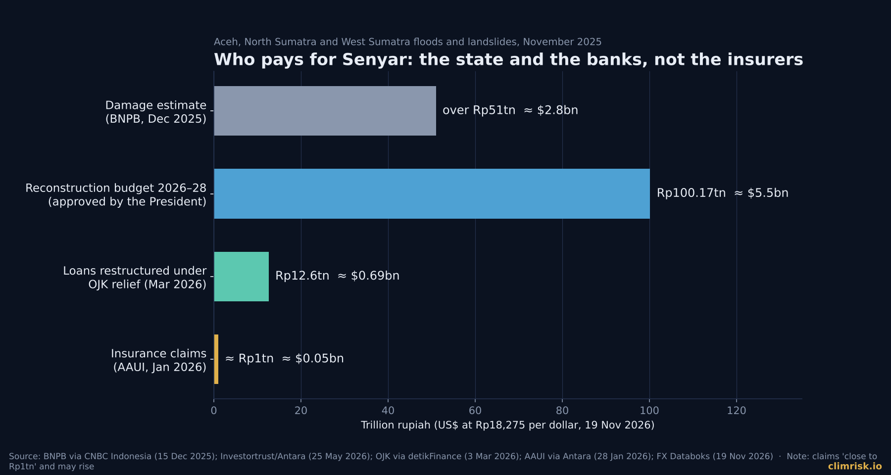
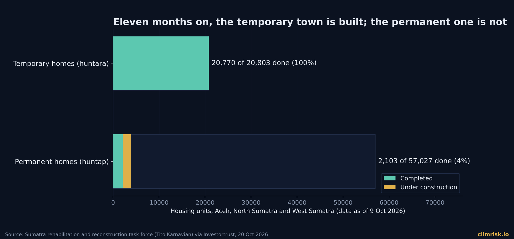
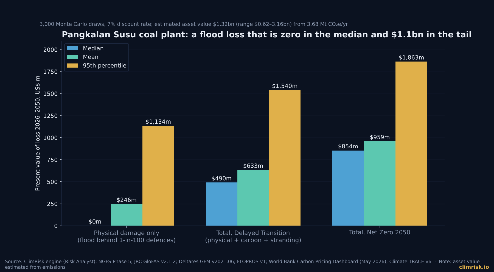

On the night of Thursday 12 November 2026, a drainage channel in Kuala Simpang, the main town of Aceh Tamiang district, overflowed into the houses beside it. About 150 people were evacuated, some of them to the temporary shelters the national disaster agency had built after last year's floods. **[BNPB 2026a]** By Sunday's preliminary count, flooding across eight sub-districts of Aceh Tamiang had affected 18,158 people and put about 885 houses under water. Six road points were cut. **[BNPB 2026b]**

Across the provincial border in Langkat, North Sumatra, the water reached between 70 cm and 2.5 m in the village of Sekoci the same morning, and 3,155 people were affected. **[BNPB 2026a]** It was the district's second flood in a month. In October, rain from a Sunday night to a Monday afternoon put parts of Langkat under more than 1.5 m of water and submerged the Trans-Sumatra Highway. **[The Star 2026]**

None of this is large by the standard of a year ago. One Besitang resident told reporters in October that "the water was not as high as it was in late November last year." **[The Star 2026]** That is the point of this piece. In late November 2025, Cyclonic Storm Senyar and the rain around it caused floods and landslides across Aceh, North Sumatra and West Sumatra that killed 1,204 people, with 140 still missing. **[BNPB via NU Online 2026]** A year on, the same districts are flooding again, and the rebuilding is far from done.

For lenders and investors, the question is no longer what one storm cost. It is what happens to a region's balance sheet when the next flood arrives before the last one has been paid for.

## The Water: A Smaller Flood on a Weakened Landscape

The November 2026 floods were ordinary monsoon-season events, not a cyclone. BNPB's national tally for 24 October to 8 November counted flooding in 12 districts and cities, 46 sub-districts and 18,511 households. **[BNPB via JournalArta 2026]** The highest three-day rainfall in the agency's briefing was 183 mm, in Aceh Barat Daya. **[BNPB via JournalArta 2026]**

What makes ordinary rain dangerous here is what last year left behind. Padang's mayor said in October that some neighbourhoods "have been hit three times since last year", and that sediment has made the rivers shallower. **[The Star 2026]** A forestry hydrologist at Universitas Gadjah Mada warned that landslide debris from 2025 can form natural dams, and that spatial planning should be "reset, not merely revised." **[The Star 2026]** The head of the government's Sumatra reconstruction task force, Home Affairs Minister Tito Karnavian, counted 41 follow-on disasters in the affected region between April and November 2026. **[ANTARA 2026]**

You can see the landscape change from space. Here is the Kuala Simpang reach of the Tamiang river three months before Senyar and two months after it.

The pale ground along the river bends and between the plantation blocks in January is bare soil and sediment where there was green cover in August. Sentinel-2 could not see the November 2026 flood: every pass over the tile from 1 to 21 November was more than 40% cloud. Radar can. The Sentinel-1 pass at 06:11 local time on 13 November, a few hours after the channel overflowed, shows new standing water against a 6 November pass from the same orbit.

The new water is small: 0.9 km² in the 145 km² both passes cover. That is consistent with BNPB's report of 30 to 40 cm of water in the streets that night. **[BNPB 2026a]**

The science points one way.

> **SOURCE — IPCC AR6 WGII, Chapter 10 (Asia), Executive Summary:** rising temperatures increase the likelihood of "floods in monsoon regions in South, Southeast and East Asia" (medium confidence).

> **SOURCE — IPCC AR6 WGI, Regional Fact Sheet: Asia:** "Average and heavy precipitation will increase over much of Asia (high to medium confidence)."

## What Is Exposed

This corner of Sumatra is palm-oil country. North Sumatra produced about 10.7% of Indonesia's palm oil in 2023 and Aceh about 2.2%, on BPS data. **[BPS via Databoks 2024]** The ClimRisk asset register, built from Climate TRACE, holds at least 80 facility records in the corridor from Medan through Langkat to Aceh Tamiang. Most are palm-oil mills and refineries. There are also power plants: PLN's gas-fired Belawan station and the Pangkalan Susu coal plant in Langkat, about 12 km north-east of Besitang.

The industry came through Senyar better than the towns. GAPKI, the palm-oil producers' association, said that no mill had stopped production because of the disaster, except one in Aceh Tamiang whose tank was displaced. The damage was mainly to access roads. **[GAPKI via Katadata 2025]** PLN's generation arm checked Pangkalan Susu after the floods and reported the plant safe; another North Sumatra coal plant, Labuhan Angin, was hit. **[Okezone 2025]**

The grid was not spared. At the peak, PLN was restoring supply to about 1.4 million customers in Aceh, and by 5 December only 52% had power back. In North Sumatra, 544,000 customers were affected. **[ESDM via Bisnis 2025]** Four 150 kV transmission towers collapsed in Bireuen. **[Liputan6 2025]**

So the exposure is mainly outside the factory fence: roads, the grid, workers' houses and the smallholders who supply the mills.

## Who Paid Last Time

This is where the finance story sits. BNPB put the damage at more than Rp51 trillion, about $2.8 billion. Insurance claims, in the insurers' association's first count, were Rp567 billion. **[CNBC Indonesia 2025]** By January the association said claims were close to Rp1 trillion, and might still rise. **[AAUI via ANTARA 2026]** On either figure, insurers carried less than 2% of the loss.

The rest landed in two places. The first is the state. The President approved Rp100.17 trillion, about $5.5 billion, for rehabilitation and reconstruction from 2026 to 2028, of which Rp38.9 trillion is for 2026. **[Investortrust 2026a]**

The second is the banking system. On 11 December 2025, the financial regulator OJK applied its standing disaster rule, POJK 19/2022, to borrowers in the three provinces. Loans up to Rp10 billion can be classified on payment timeliness alone, restructured loans can be treated as current, and the relief can run for up to three years. **[OJK 2025]** By March, Rp12.6 trillion of credit across about 246,000 accounts had been restructured. **[OJK via detikFinance 2026]**

Forbearance buys time. It does not repay a loan. It assumes that borrowers will recover before the relief runs out, and that nothing new goes wrong in between.

## Eleven Months Later

The recovery numbers show how much time is needed. As of 9 October 2026, the task force reported 20,770 of 20,803 planned temporary homes built. Of 57,027 planned permanent homes, 2,103 were finished and 1,844 were under construction. All 107 national road segments and 43 national bridges had been restored. **[Investortrust 2026b]**

Fewer than 4% of the permanent houses were finished eleven months after the event. That leaves tens of thousands of families, and the small firms around them, in temporary housing through a second wet season.

## What the ClimRisk Engine Says

We ran the engine's hazard screen at Besitang and Kuala Simpang, and its full four-stage Risk Analyst on the Pangkalan Susu coal plant.

At both town points, the engine's river-flood depth, read from the JRC global river flood maps within 250 m of the point, is zero at every return period from 1-in-10 to 1-in-500. Coastal depth is zero to 2050. On the cyclone side, only two storms have passed within 200 km of Besitang since 1980, and none at tropical-storm force there. **[ClimRisk engine 2026]**

That is a candid result, and it is incomplete in two ways. First, the floods that hit these towns in 2026 came from local channels, short rivers and rain, which global river maps at this scale do not resolve well. Second, our copy of the storm record does not yet include the 2025 season, so Senyar itself is absent. A storm that killed more than a thousand people does not register in the cyclone history at the place it hit. Readers of our Florida piece will recognise the pattern: the hazard that arrived is the one the standard layers say is not there.

Pangkalan Susu tells a different story. The plant sits on the coast. Undefended, the engine models a 1-in-100-year river flood of about 1.0 m over the site and a 1-in-100-year coastal flood of 2.15 m today, rising to 2.34 m by 2050. FLOPROS assigns North Sumatra a 1-in-100-year defence standard for both. Behind those defences, the modelled average annual damage is 1.25% of value. **[ClimRisk engine 2026]**

The shape of that loss is the insight. The physical-damage present value to 2050 has a median of zero, a mean of $246m and a 95th percentile of $1.13bn, on an estimated asset value of $1.32bn. **[ClimRisk engine 2026]** In most simulated futures, the defences hold and nothing happens. In the worst one in twenty, a flood above the design standard does damage close to the value of the plant. A single "expected loss" number hides that. It also rests on a defence standard we have not verified on the ground.

Transition risk sits on top. Indonesia's emissions trading system covers the plant at an effective price of $0.7 a tonne today, with free, intensity-based allocation. **[World Bank Carbon Pricing Dashboard 2026]** Under the NGFS Phase 5 Delayed Transition scenario, the engine's total loss to 2050 has a mean of $633m, a median of $490m and a 95th percentile of $1.54bn. Under Net Zero 2050, the mean is $959m. Under Current Policies, the carbon bill is small, $30m in present value, and physical damage is the larger part of the risk. **[ClimRisk engine 2026]**

The plant value is estimated from its 3.68 Mt CO₂e of annual emissions, with a range of $0.62bn to $3.16bn. The percentages are indicative. The shape is not.

## How the Next Flood Reaches Balance Sheets

Four pathways matter.

1. **Stacked forbearance.** Loans restructured after Senyar are still inside their relief window. A new flood hits borrowers who have not yet recovered. Lenders in Aceh and North Sumatra should track how much restructured credit sits in districts that flooded again in 2026.
2. **Fiscal crowding.** Reconstruction is a three-year budget. The task force told the President in November that 2027 needs are about Rp42 trillion, including unspent 2026 funds. **[JournalArta 2026]** Each new event competes for the same money.
3. **Supply-shed risk.** Mills kept running after Senyar, but they depend on roads, power and smallholder fruit. Business interruption from cut access is not in our engine numbers, and it is the more likely loss.
4. **Tail risk at coastal plant.** For assets like Pangkalan Susu, the risk is low-probability and high-severity. It belongs in stress tests, not just in expected-loss averages.

## What Investors, Lenders and Operators Should Do

First, read a zero flood score in a small-river, high-rainfall district as "not assessed". Ask whether surface-water and small-catchment flooding are in the model.

Second, treat recent disasters as a change in the hazard, not just a past loss. Sediment, landslide dams and stripped slopes raise the chance of the next flood for years. A model calibrated on the pre-2025 landscape will understate it.

Third, for banks, map restructured loans against 2026 flood footprints. BNPB publishes district-level reports, and they are enough to start.

Fourth, for owners of coastal plant, ask for the actual design level of the site's flood defences and the cost of the 1-in-20 outcome, not only the average.

## Method and Limitations

Cyclone hazard uses NOAA IBTrACS v04r01 tracks since 1980 with a Holland (1980) wind profile; our copy does not include the 2025 season. River flood depths are from the JRC CEMS-GloFAS global maps v2.1.2 (undefended); coastal depths from Deltares Global Flood Maps v2021.06 with sea-level rise to 2050. Defence standards are from FLOPROS v1 and are policy-layer values. Damage uses JRC depth-damage curves for industrial assets in Asia. Pangkalan Susu's value is estimated from emissions; the engine reports direct physical damage only. BNPB figures are preliminary situation reports and change as counts are revised. Rupiah are converted at Rp18,275 per dollar (19 November 2026). The Sentinel-1 water mask uses a −18 dB threshold and is a screening product.

## How ClimRisk Measured This

We ran the ClimRisk engine's hazard screen at Besitang (4.03°N, 98.20°E) and Kuala Simpang (4.28°N, 98.06°E), and its four-stage Risk Analyst on the Pangkalan Susu coal plant from our asset register: physical hazards with flood defences, carbon-pricing instruments in force from the World Bank dashboard, NGFS Phase 5 transition scenarios, and a Monte Carlo loss distribution with 3,000 draws, a 7% discount rate and emissions unabated unless stated. Values are present values for 2026 to 2050 in US dollars. Satellite scenes are real Copernicus Sentinel-1 and Sentinel-2 data processed by ClimRisk. The result we most want readers to keep is the gap between the two halves of this story: a region that has already paid once, mostly through the state and its banks, and the standard hazard layers that say it should not have had to.
