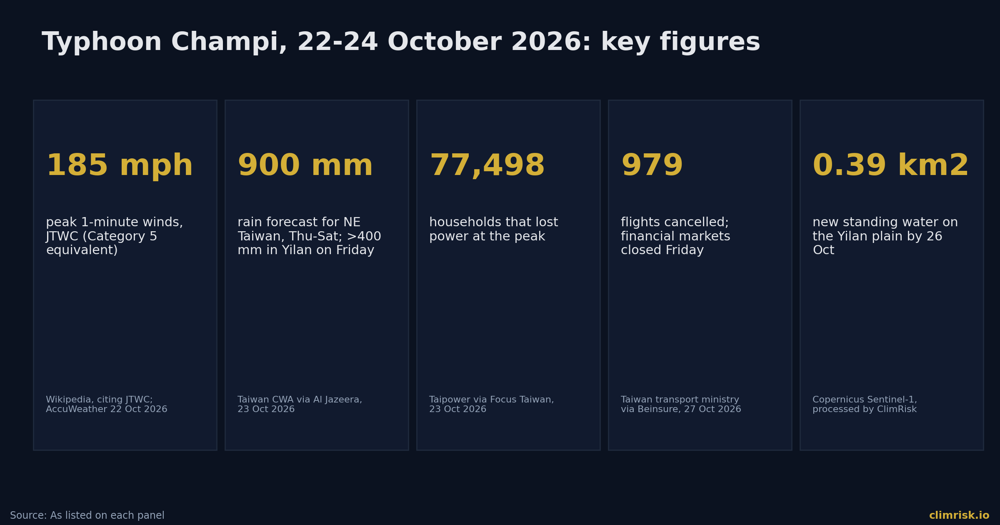
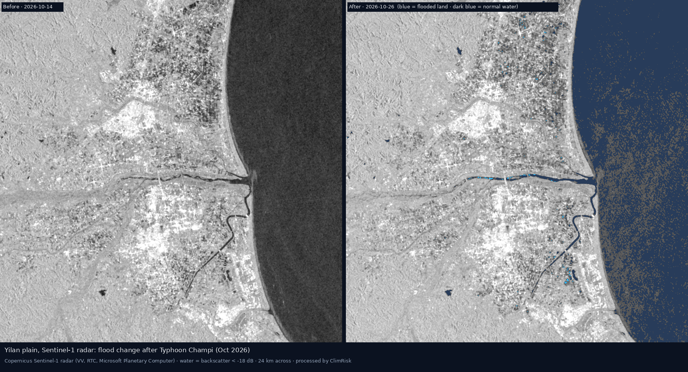
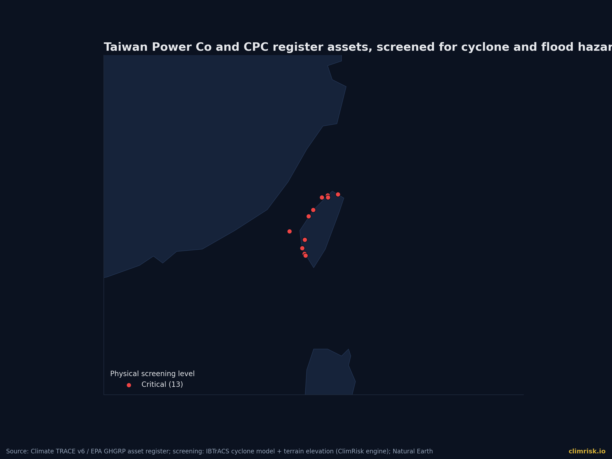
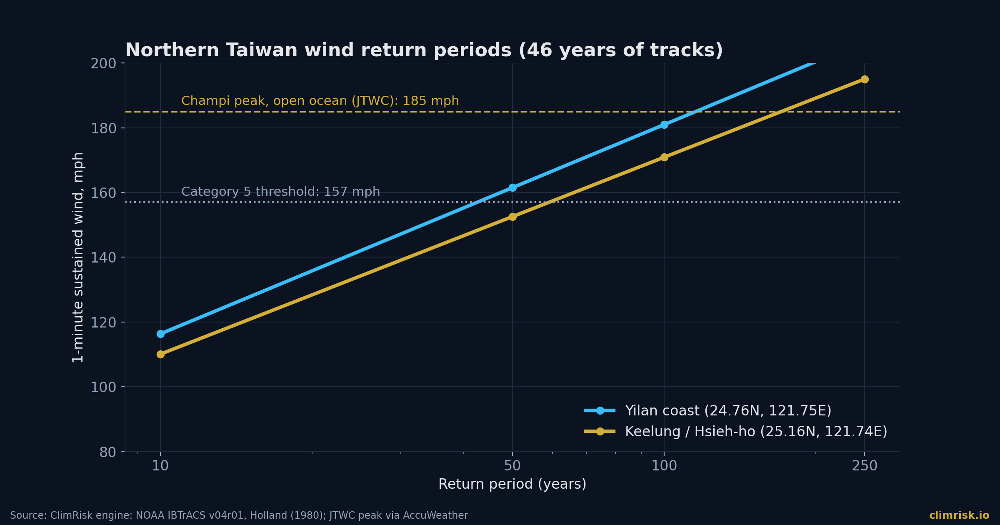
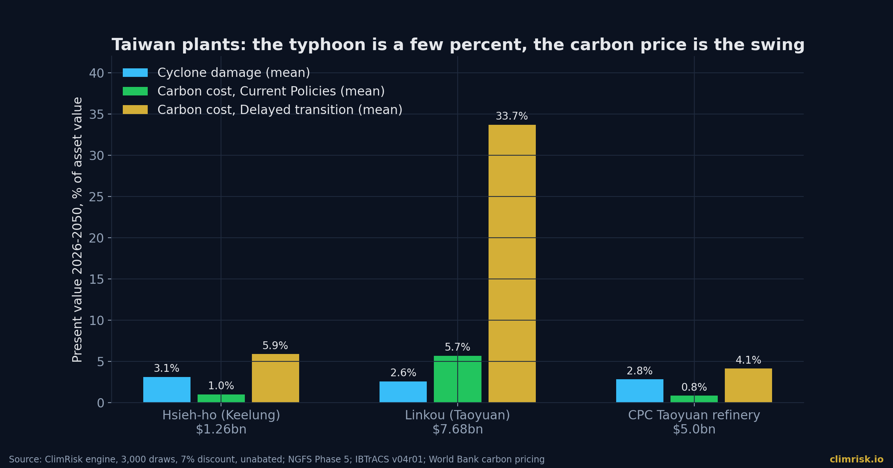

On Friday 23 October 2026, Taiwan's financial markets, schools and government offices closed across nearly the whole island, and 979 flights were cancelled. **\[Beinsure 2026\]** The storm responsible, Typhoon Champi, had peaked days earlier as a Category 5-equivalent super typhoon with 1-minute winds of 185 mph. **\[AccuWeather 2026\]** By the time it passed Taiwan's northeast coast it was weaker, but it still brought up to 900 mm of rain to the northeast, with more than 400 mm falling in Yilan County in a single day. **\[Taiwan CWA via Al Jazeera 2026\]**

One person died and hundreds were injured. Reported injury counts differ by outlet and by hour, from 94 early on Friday to more than 500 later. **\[Focus Taiwan 2026; Al Jazeera 2026; Beinsure 2026\]** No loss estimate for Champi from an official body or insurer had appeared in the sources we checked by 2 November. This piece does what we can do without one: it measures the hazard, tests what the storm did and did not do on the ground, and asks what it says about the climate risk of Taiwan's power and refining assets over the next 25 years.

The answer is a little counter-intuitive. The loud risk, the typhoon, is real but modest on an asset-value basis. The quiet one, the price of carbon, is where the big numbers sit.

## The Storm: A Super Typhoon That Skirted the Coast

Champi formed near Micronesia on 11 October and rapidly intensified, reaching Category 5-equivalent by 17 October. **\[Wikipedia 2026\]** It passed within about 12 miles of the southern tip of Guam on 18 October. **\[AccuWeather 2026\]** AccuWeather reported that it tied for the strongest 1-minute winds of any storm on Earth this year, 185 mph, on 21 October. **\[AccuWeather 2026\]**

Then it weakened. On Friday the US Joint Typhoon Warning Center put its maximum winds at 185 km/h (115 mph), and it swept past Taiwan's northeast rather than making a clean landfall. **\[Al Jazeera 2026\]** Taiwan's Central Weather Administration recorded gusts of around 191 km/h (119 mph) near the centre, with the storm about 170 km east of the island at one point. **\[Beinsure 2026\]** It then recurved towards Japan's southern islands, where about 8,400 households lost power in Okinawa and two people were injured. **\[Al Jazeera 2026\]**

> **SOURCE — Al Jazeera, 23 October 2026 (citing AFP and Reuters):** the storm was "briefly a super typhoon with winds of nearly 300 kilometres per hour" but had since weakened.

That distinction matters for anyone modelling exposure. A storm's open-ocean peak is not the wind a plant feels. What a plant feels is set by the track, the distance and the storm's state at the point of closest approach. Champi's peak was a headline; at its closest approach it was a weaker storm, with the JTWC reading 115 mph on Friday.

## What the Storm Did on the Ground

The visible damage was the kind that interrupts operations rather than destroys assets. Taipower reported that 77,498 households lost electricity at the peak, with about 75% restored by 2 p.m. Friday. **\[Taipower via Focus Taiwan 2026\]** Waves of up to 6 m toppled a large crane into the sea at Fugang Fishing Port in Taitung, and a section of Provincial Highway 9 was washed away at Duoliang. **\[Focus Taiwan 2026\]** Taiwan's transport ministry said 979 flights were cancelled. **\[Beinsure 2026\]** TSMC said its operations remained normal. **\[Beinsure 2026\]**

We also looked from space. ClimRisk processed Copernicus Sentinel-1 radar, which sees through cloud, for the Yilan plain, the part of Taiwan that received the heaviest rain. Comparing a pass on 14 October with one on 26 October, three days after the storm, we found about 0.39 km² of new standing water in a 24 km-wide scene.

That is a small number and it should be read as one. By 26 October the water had had three days to drain, and standing water is not the same as peak inundation. The honest reading is that the flood pulse on Yilan's low-lying plain was brief, and that radar a few days later shows little left of it. It does not tell us what the peak depth was on the 23rd.

## Who and What Is Exposed

The storm's track put Taiwan's northeast, the Keelung–Taipei–Taoyuan corridor, in the zone of strongest winds and heaviest rain. That corridor is also where a large part of the island's thermal power and refining sits.

The ClimRisk register holds 13 assets for Taiwan Power Co, CPC Corporation and Taiwan Cogeneration, with a benchmark value of about $66.7bn. For this piece we ran the engine's full Risk Analyst on three in the northern corridor: the Hsieh-ho power plant in Keelung ($1.26bn), the Linkou power station in Taoyuan ($7.68bn, 15.0 Mt CO₂ a year), and CPC's Taoyuan refinery ($5.0bn).

## What the ClimRisk Engine Says About the Hazard

We ran the engine's cyclone model, built on NOAA's IBTrACS best-track archive since 1980, at the Yilan coast and at Keelung.

At Yilan, 107 storms have passed within 200 km in 46 years, 72 of them at tropical-storm strength or above and four at Category 3 or stronger. The strongest, Krosa in 2007, reached about 58 m/s (130 mph) at the site. The engine puts the 1-in-10-year wind at about 116 mph and the 1-in-100-year at about 181 mph. At Keelung the 1-in-100-year wind is about 171 mph. In other words, a Category 5 on this coast is a 1-in-100 event, not a freak, and Champi's open-ocean peak is the right order of magnitude for that return period.

Coastal flood depths from the Deltares maps are zero at these sites for every return period we read, and the river-flood map could not be read at Linkou, so we do not report a river-flood result there. The flood-defence layer (FLOPROS) also returns no protection standard for these units. Treat the flood result as incomplete, not as a clean bill of health.

## What It Means for Asset Value

Across the three plants the physical result is consistent and modest. Cyclone damage has an average annual loss of about 0.22% to 0.27% of asset value, which is $3.4m a year at Hsieh-ho, $17.0m at Linkou and $11.9m at the Taoyuan refinery. Over 2026–2050, discounted at 7%, the mean present value of cyclone damage is 2.6% to 3.1% of asset value, and the 95th percentile is 7.9% to 9.3%. At Linkou that is $197m on average and $609m at the 95th percentile. A 1-in-100-year year costs Linkou about $342m.

Those are real numbers, but they are damage only. The engine does not price business interruption, and for a power plant the interruption can cost more than the repair.

## The Quiet Risk: Carbon

Taiwan's carbon fee is $9.4 a tonne. **\[World Bank Carbon Pricing Dashboard 2026\]** On that price a plant pays little. Under the NGFS Phase 5 Current Policies scenario, the engine's median carbon price is still only about $13 a tonne in 2050, and the carbon cost to Linkou has a present value of $436m, or 5.7% of its value.

Under the NGFS Delayed Transition scenario the picture changes. The median carbon price stays at $9.4 in 2030, then rises to about $170 in 2040 and $401 in 2050. If Linkou's 15.0 Mt a year of emissions go unabated, the present value of the carbon bill is $2.6bn on average and $5.5bn at the 95th percentile. That is 34% of the plant's value on average, against 2.6% for cyclone damage. The same arithmetic at the Taoyuan refinery, which emits 1.6 Mt a year, gives a carbon cost of $205m (4.1%). At Hsieh-ho, a much smaller emitter, it is $74m (5.9%).

For the whole 13-asset portfolio, the engine's mean total loss to 2050 under Delayed Transition is $16.0bn, or 23.7% of value, with a 95th percentile of $19.6bn. Under Current Policies it is $8.3bn (12.2%). The physical loss in the portfolio total is a lower bound, because river flood was read for none of the 13 assets.

This is a cost of inaction, not a forecast. It assumes no abatement, no pass-through to customers and that the fee reaches the plant as a tax. Taiwan's power market is state-dominated and its tariffs are regulated, so who bears a higher carbon price is a policy choice. That is exactly why investors and lenders should ask the question now.

## What Investors, Lenders and Operators Should Do

First, separate the two risks in your own models. A typhoon is a frequent, bounded, insurable hazard. A carbon price is a path-dependent policy variable that can move an asset's value by tens of percent.

Second, ask for track-based wind return periods at the plant, not storm headlines. Champi's 185 mph was an ocean number; the engine's 1-in-100 at Keelung is 171 mph.

Third, treat business interruption as its own line. Taipower restored most of the 77,498 households within hours, which is a good operating result, but the data we have say nothing about outage cost to the plants themselves.

Fourth, for lenders with thermal exposure, ask for the abatement plan. The delayed-transition number is the one that changes a covenant.

## Method and Limitations

The cyclone model uses IBTrACS v04r01 tracks since 1980, a Holland (1980) wind profile and the Emanuel (2011) damage curve for the West Pacific. Frequencies are historical and carry no climate-change uplift. Flood maps are the JRC river and Deltares coastal products, undefended; FLOPROS returned no standard for these units. Asset values are register benchmarks, and emissions are as recorded in the register; both should be checked with the owner. Direct physical damage only. Injury counts, flight counts and outage counts are as reported by the outlets named and differ between them. The Sentinel-1 water mask uses a backscatter threshold of −18 dB and is a screening product.

## How ClimRisk Measured This

We ran the ClimRisk Risk Analyst on three northern Taiwan assets and on the full Taiwan Power Co and CPC portfolio: IBTrACS cyclone event sets, JRC and Deltares flood depths, FLOPROS defences, World Bank carbon-pricing instruments and NGFS Phase 5 scenarios, with 3,000 Monte Carlo draws and a 7% discount rate. Values are present values for 2026–2050 in US dollars, with emissions unabated. We report the mean and 95th percentile, not a single number.
